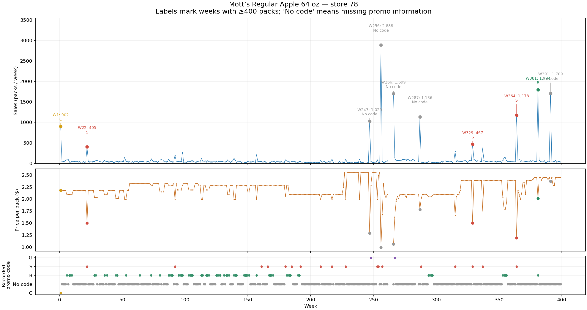
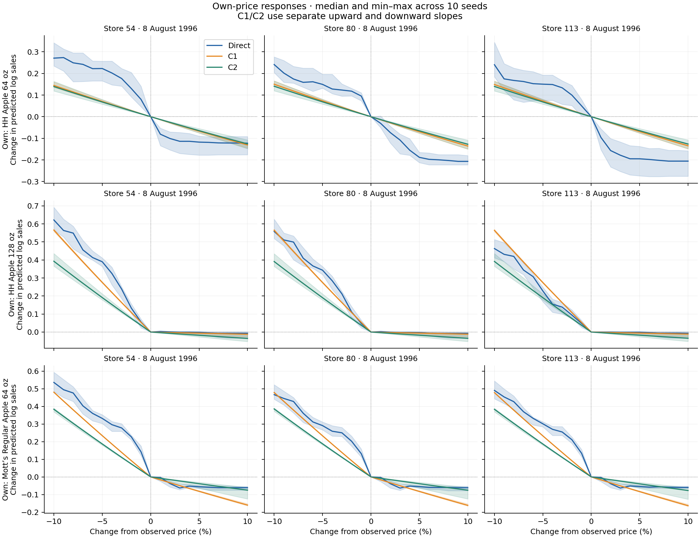

# Retail pricing: forecasts, experiments and learning

This project was developed in collaboration with OpenAI Codex.

A learning project about the full pricing cycle: **collect evidence → model demand and price response → design a pricing policy → evaluate the policy**.

The project goes beyond predicting sales and maximizing predicted profit: what evidence is needed before price recommendations deserve trust? Historical data provide the starting point; controlled price experiments in a simulator are the next stage.

## Project stages

| Stage | Question | Status |
|---|---|---|
| 1. Historical data | Do accurate demand forecasts also give stable, plausible price responses? | **Completed** — Dominick's, 11 juice products |
| 2. Consumer simulator | Can we create a controlled environment with a known demand mechanism? | **In progress: design only** |
| 3. Price experiments | How can we collect enough evidence to estimate demand and price response? | Planned |
| 4. Policy experiments | How do the demand model, objective and price constraints shape a policy? | Planned |
| 5. Policy evaluation | Does a frozen policy beat fixed prices on future simulations? | Planned |
| 6. Contextual bandits | Can adaptive experimentation improve the learning/profit trade-off? | Planned |

**Start here:** [Detailed methods and tables](docs/technical_appendix.md) · [Reproduction](docs/reproduction.md)

## Part I: what we did

- Model 11 products together, allowing own- and cross-price responses.
- Compare a shared CatBoost with two models that separate baseline demand and price response.
- Check forecast errors, price-response curves, finite-difference steps and ten training seeds.
- Check which price levels were common or rare in the historical data.
- Inspect raw sales, promotions, missing observations and extreme weekly peaks.
- Use profit optimization as a **sanity check**, not as evidence of attainable profit.

For more details on the methods and results, see the [Part I report](docs/part_1_historical_data.md).

### Data

- **Source:** [Dominick's weekly scanner data, Kilts Center, University of Chicago Booth](https://www.chicagobooth.edu/research/kilts/research-data/dominicks).
- **Scope:** 11 selected juice products; the raw-data audit covers 93 stores and weeks 1–399. Model evaluation uses a narrower complete-price sample.
- **Observed:** sales, prices, promotion codes, product and store information.
- **Missing from our inputs:** inventory and replenishment, shelf availability, complete advertising/displays, verified advance promotion plans, customer baskets and managers' demand forecasts.
- **Zero sales:** we cannot tell whether a recorded zero means no demand or no available stock. We therefore excluded these observations from our demand model.

The source project included randomized experiments, but we did not reconstruct or use their assignment.



*The same product can show very different sales at similar prices. Some large peaks have no recorded promotion code. Missing codes do not establish the absence of a campaign.*

We acknowledge the Kilts Center for Marketing at the University of Chicago Booth School of Business. Source data are for academic research; raw files are not redistributed. [Data notes](data/README.md).

### Three models

Let $Y_i=\log Q_i$, $X$ be the available context, $p_j^0$ the previous-week price and $d_j=\log(p_j/p_j^0)$. The vectors $\mathbf p$ and $\mathbf d$ collect prices and log-price changes for all 11 products; $\mathbf D$ denotes observed log-price changes. Define $d_j^+=\max(d_j,0)$ and $d_j^-=\min(d_j,0)$.

**Direct — shared CatBoost**

$$\widehat Y_i=f_D(i,X,\mathbf p).$$

**Anchored models — separate reference demand and price response**

$$\widehat Y_i=b(i,X)+T_i^+(X)\mathbf d^++T_i^-(X)\mathbf d^-.$$

- $b$: a shared CatBoost trained on filtered observations where the product’s own price stayed unchanged, without target-week prices or promotions. Other prices can still change, so this is only an approximation to demand under an unchanged price vector.
- $T^+,T^-$: own-price coefficients depend on selected context and store; cross-price coefficients are shared across contexts within each direction.
- **C1, hybrid:** fit the response to past-only baseline errors $Y-b$. This can correct baseline errors as well as price effects.
- **C2, residualized:** estimate $m(i,X)=E[Y_i\mid X]$ and $e^\pm(X)=E[\mathbf D^\pm\mid X]$, then fit $Y-m$ against $\mathbf D^\pm-e^\pm$.

C2 was the main methodological idea. Its residualization follows [Double Machine Learning](https://arxiv.org/abs/1608.00060) and the [R-learner](https://arxiv.org/abs/1712.04912). The theoretical motivation is stronger for isolating a price component, **under the required assumptions**. It does not guarantee that our final anchored forecasts are causal: replacing the implied reference level with $b$ is an additional approximation.

C1 is a simpler experimental comparison. It forecasts better than C2 in our later sample; this does not establish better causal effects.

### Main results

Same later-period sample: 16,764 product–store–week rows, 1,524 store-weeks. Lower logRMSE is better.

| Model | logRMSE |
|---|---:|
| Direct | **0.4907** |
| C1 | 0.4941 |
| C2 | 0.5099 |

**Stability across ten training seeds.** We compare log-demand responses to log-price changes at the same contexts and price intervals: finite differences for Direct, and the corresponding contrasts from C1/C2 coefficients. For each matched response, measure its standard deviation (SD) across runs; then summarize these SDs. Lower values mean greater repeatability.

| Model | Response | Median SD | P90 SD | Material sign reversals |
|---|---|---:|---:|---:|
| Direct | Own | 0.2801 | 0.4423 | 0.86% |
| Direct | Cross | 0.0196 | 0.0650 | 1.47% |
| C1 | Own | 0.0292 | 0.0607 | 0.09% |
| C1 | Cross | 0.0057 | 0.0120 | 0.00% |
| C2 | Own | 0.1195 | 0.1497 | 0.02% |
| C2 | Cross | 0.0269 | 0.0481 | 0.00% |

P90 is the 90th percentile of these SDs and describes the less stable tail. A material reversal means the same response is below −0.1 in one run and above +0.1 in another. These are repeatability checks, not causal confidence intervals. C2 cross responses have a higher median SD than Direct but a lower P90: the comparison is mixed.

Forecast scores use retained single fits; seed statistics summarize ten refitted pipelines. The later period was repeatedly inspected and is **not an untouched test set**.



*Same contexts, three products and three stores. Lines are medians over ten seeds; bands are min–max ranges, not confidence intervals.*

- C1/C2 own responses were more repeatable across seeds in this experiment.
- Simpler curves partly reflect restrictions we imposed. Stability is not proof of correctness.
- Deep discounts remain difficult, especially for C2.
- Restricting training to moderate price changes did not produce a consistent forecast improvement.

### Profit optimization: a sanity check

We used predicted sales to maximize estimated **gross profit of all 11 products**:

$$\widehat\Pi(\mathbf p)=\sum_i(p_i-\widehat c_i)\widehat Q_i(\mathbf p).$$

- Compare constrained candidate prices using past cost proxies and synthetic sales caps.
- Inspect selected prices, boundary hits, own/cross sales changes and revenue/profit contributions.
- Repeat after restricting training to moderate changes: $|\log(p_j/p_j^0)|\leq-\log(0.70)$ for all products — **−30% to +42.86%**, symmetric in logs.
- In the previous-week-centered check, change one product at a time; hold all other prices at their previous-week values. Actual target-week prices are used only for comparison afterwards.

**The resulting recommendations are difficult to trust.** In that check, the moderate-training models chose price increases of at least 40% in **94.6% / 80.1% / 84.2%** of decisions for Direct / C1 / C2. Filtering did not resolve the tendency to favour the upper boundary.

These are model-based scenarios, not a controlled policy experiment. Synthetic caps are not inventory, and projected profit gains are not demonstrated gains. We did **not** obtain a validated pricing policy. [Sanity-check figures and discussion](docs/part_1_historical_data.md#5-optimization-sanity-checks).

## Conclusion

The difficulties are consistent with a basic limitation: we are trying to estimate a complex price-response surface from limited and uneven price variation.

- Products often change price together, making their separate effects difficult to identify.
- Price changes can coincide with promotions and other conditions that we do not fully observe.
- A large number of sales records does not necessarily provide enough independent price variation to estimate own- and cross-price effects.

Simpler models can make the estimated responses more stable, but they cannot supply evidence missing from the data. This helps explain why reasonable forecasts and repeatable responses did not lead to convincing pricing recommendations.

More credible policy evaluation requires deliberate price experiments, or a defensible way to identify historical price variation that is independent of unobserved demand changes. This is the motivation for the next stage: collect controlled evidence in a simulator and test the resulting policies against a known demand mechanism.

## Next: controlled experiments in a simulator

- **Build the environment:** a known demand mechanism with roughly realistic scales.
- **Price experiments — collect data:** vary prices around a fixed-price baseline; compare exploration duration and range.
- **Policy experiments — develop the policy:** fit demand models, choose the profit objective and constraints, and compare the resulting pricing rules on development simulations.
- **Policy evaluation — test the frozen policy:** compare with fixed prices and an oracle on new simulation periods; include profit earned or lost during learning.
- **Contextual bandits — adapt while learning:** compare sequential price exploration, including Thompson sampling, with the fixed experiment-then-policy approach.

Simulator results will validate methods **within the simulated environment**, not establish real-world returns.

## Run and explore

```bash
python -m venv .venv
source .venv/bin/activate
pip install -e '.[dev]'
python scripts/rebuild_summary.py
python -m pytest
```

This rebuilds the forecast chart from included aggregate results and checks the portable response estimator. Historical raw-data training requires separately obtained data and prepared temporal inputs; it is **not** claimed to be a one-command rebuild. See [reproduction levels and commands](docs/reproduction.md).

```text
README.md                  project overview
docs/                     Part I, methods, roadmap, reproduction
figures/                  selected published figures
results/                  aggregate tables and provenance
src/retail_pricing/        portable C1/C2 response estimator
scripts/                  summary rebuild, data audit, response refit
notebooks/                compact reader notebook
configs/                  exact feature and fold contract
tests/                    mathematical and regression checks
```
