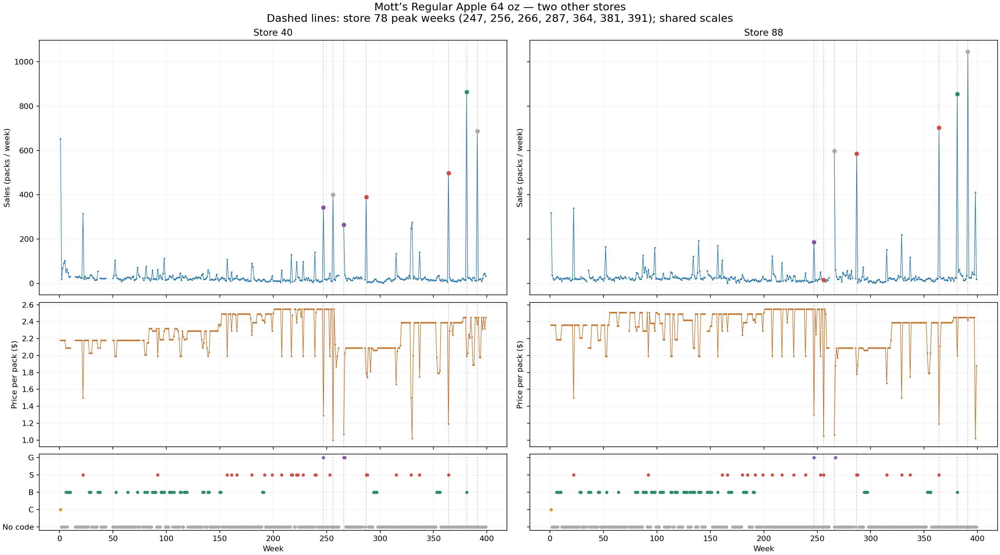
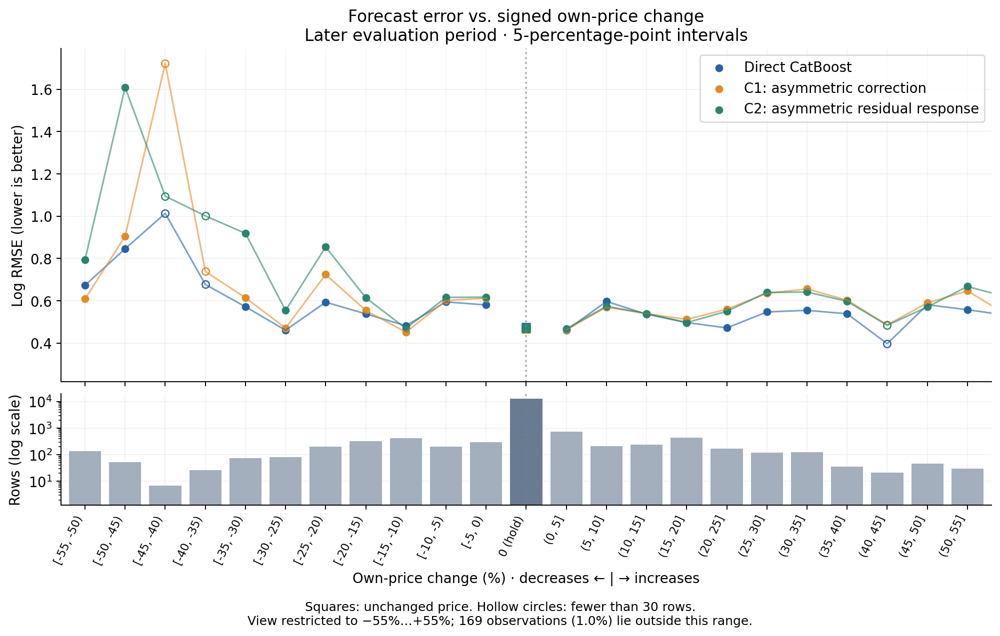
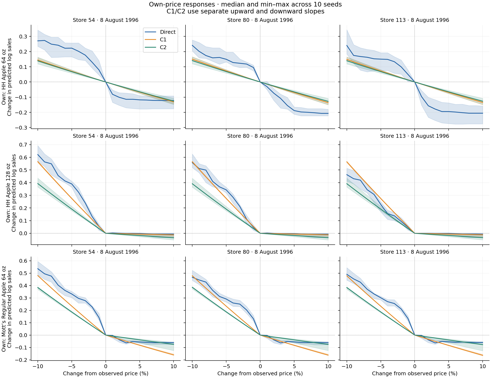
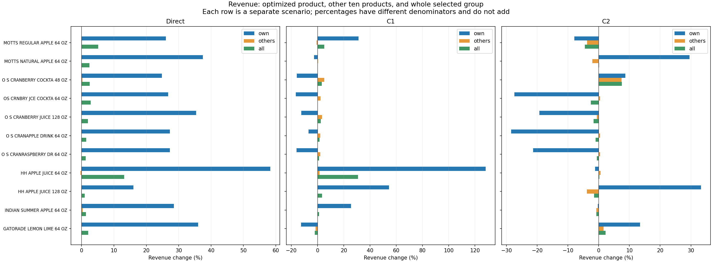

# Part I — Historical demand and price responses

This project was developed in collaboration with OpenAI Codex.

## Purpose and project map

This project explores pricing methods through a complete workflow. Part I uses real data to study demand models and the limits of their price recommendations.

- **Completed:** historical demand modelling, response diagnostics and optimization sanity checks.
- **In progress, design:** a consumer simulator with a known demand mechanism.
- **Planned:** price experiments to collect data; policy experiments to develop pricing rules; separate policy evaluation; contextual bandits.

The main question is whether a model that predicts sales well also provides a useful surface for changing prices. Forecast accuracy, price-response accuracy, and stability/plausibility are different properties.

## 1. Data: what happens before modelling

- Dominick's weekly scanner records; 11 selected bottled-juice products.
- Raw selected records cover 93 stores and weeks 1–399.
- The raw-data audit retains 357,051 records with `OK=1` and nonnegative sales, including 12,925 zeros.
- The forecasting pipeline uses positive-price, positive-sales rows. It therefore does not model the zero-sales margin.
- Raw-data EDA uses individual product histories. Model comparisons require complete selected price vectors and cover a narrower sample.
- Changes are between adjacent calendar weeks, never across a missing week.

### Large peaks and incomplete promotion information

In store 78, Mott's Regular rises from 21 to 2,888 packs in week 256 as price falls from $2.55 to $0.99. The recorded promotion code is empty. At week 391, sales reach 1,709 packs at $2.37, again without a code.

Some peaks occur in several stores at once. Week 391 sales are 1,709 / 687 / 1,045 packs in stores 78 / 40 / 88. Week 256 is different: 2,888 / 401 / 15 packs at similar prices. These patterns suggest shared events plus store-specific conditions; they do not identify a stockout or a causal price effect.

The neighbouring weeks show a sequence of discounts:

| Week | Product | Previous → current price | Previous → current sales |
|---|---|---|---|
| 255 | HH Apple 64 | $1.99 → $1.00 | 79 → 1,067 |
| 256 | Mott's Regular | $2.55 → $0.99 | 21 → 2,888 |
| 256 | Mott's Natural | $2.55 → $1.00 | 9 → 279 |
| 257 | Indian Summer | $2.45 → $1.28 | 3 → 266 |

- HH's decline coincides with its own price returning upward; it cannot be attributed solely to Mott's.
- Mott's Natural rises alongside Regular. There is no broad collapse in all other selected products.
- Mott's returns to 52, 27, 25 and 50 packs in the next four weeks. This window does not show a clear post-promotion trough.
- Replenishment, advertising, display changes and household stockpiling are possible explanations. These records cannot distinguish them.

### Variation and coverage

- Median coefficient of variation across SKU-store histories: **0.94**.
- Median maximum/minimum-positive sales ratio: **88**. One-unit weeks make this measure unstable; percentile ratios are a useful companion.
- Across-store regressions of price variance against sales variance are weak: the largest raw $R^2$ is about **0.09**.
- Store 88's earlier error heatmap represented only one evaluated week, although most individual product histories contain 387 valid weeks. Complete-vector selection can create misleading store comparisons.

[Sales variability](../figures/cv_all.png) · [Zero-sales frequency](../figures/zero_share_all.png) · [Price/sales changes](../figures/price_sales_scatter.png) · [Variance comparison](../figures/variance_regression_raw_all.png)

All-history EDA includes the previously inspected evaluation period. It is descriptive, not a new validation set. A missing row is not an observed zero, and neither establishes an empty shelf.

### Information missing from our modelling inputs

| Missing or incomplete information | Why it matters |
|---|---|
| Inventory, deliveries, shelf availability | Sales may be limited by availability; replenishment can coincide with promotion |
| Full advertising, displays and campaign terms | A price cut can arrive with a separate demand shock |
| Verified advance promotion plans | Target-week codes are used as proxies, not proven decision-time plans |
| Manager forecasts and pricing rules | Prices may respond to expected demand that we cannot observe |
| Full assortment, outside competitors, customer baskets | Switching and complementary purchases are only partly observed |
| Within-week transactions and price timing | Weekly aggregates hide timing and differing purchase conditions |
| Verified procurement costs and supplier funding | Reconstructed margins need not equal the true incremental economics |

Store traffic is not used in our model; the source collection has a separate customer-count file. “Not used” should not be confused with “unavailable anywhere.” The source project also included randomized experiments; their assignment is not reconstructed here.

## 2. Models

For product $i$, let $Y_i=\log Q_i$ and $d_j=\log(p_j/p_j^0)$, where $p_j^0$ is the previous-week price. Context $X$ includes historical features and calendar information. Product identity enters the shared models.

### Direct demand model

$$\widehat f_D=\arg\min_f\sum_{n,i}[Y_{ni}-f(i,X_n,\mathbf p_n)]^2.$$

A shared CatBoost receives context and the full candidate price vector. All price-derived features are updated when prices change.

### Anchored structure

$$f_A(i,X,\mathbf p)=b(i,X)+T_i^+(X)\mathbf d^++T_i^-(X)\mathbf d^-,$$

where $d^+=\max(d,0)$ and $d^-=\min(d,0)$. The $11\times11$ matrices allow different responses to increases and cuts. Their diagonals describe own-price effects; off-diagonals describe cross-price effects.

- **B:** shared CatBoost on filtered own-price-HOLD observations. It excludes target-week prices and promotions. Peer prices can still move, so B approximates an all-prices-unchanged reference.
- **T:** structured ridge regression, with context/store-specific own effects and pooled cross effects within each direction. No sign constraints.
- The function is continuous at zero but can have different one-sided slopes.

### C1 — hybrid forecast correction

$$\min_{T^+,T^-}\sum_{n,i}\left[Y_{ni}-\widehat b^{\rm past}(i,X_n)-\sum_{s\in\{+,-\}}T_i^s(X_n)D_n^s\right]^2+\mathcal P(T).$$

Past-only baseline errors are the target. C1 can learn both a price response and a correction for baseline misspecification. Its better forecast accuracy relative to C2 is useful, but does not establish cleaner price effects.

### C2 — residualized response

$$m(i,X)=E[Y_i\mid X],\qquad e^s(X)=E[D^s\mid X].$$

$$U=Y-\widehat m^{\rm past},\qquad V^s=D^s-\widehat e^{s,\rm past}.$$

$$\min_{T^+,T^-}\sum_{n,i}\left[U_{ni}-\sum_{s\in\{+,-\}}T_i^s(X_n)V_n^s\right]^2+\mathcal P(T).$$

- $m$ averages demand over historical price actions. It is not the HOLD model B.
- CatBoost estimates $m$; a shared 22-output neural network estimates the means of the positive and negative price-action components.
- Split actions by direction **before** residualization.
- Past-only temporal cross-fitting respects a two-week label delay.
- The construction follows DML/R-learner residualization. It reduces first-order sensitivity to nuisance errors under suitable assumptions; it does not remove hidden confounding.

The residual model implies a reference level

$$g(i,X)=m(i,X)-\sum_sT_i^s(X)e^s(X).$$

Our final forecast replaces $g$ with B. **The assumption $b\approx g$ is additional and imperfect.** C2 is theoretically motivated for response estimation, but this does not make the complete anchored system a validated causal estimator.

### Restrictions and inputs

Cross effects are shared across stores and weeks within each direction. Own effects use calendar sin/cos, permitted B-promotion proxies, historical price/reference features, price-per-volume context and centered store indicators. This pools limited variation rather than estimating 242 flexible functions independently.

Write $T^+=A+H$, $T^-=A-H$; ridge penalties on both $A$ and $H$ limit coefficients and shrink directional differences. Direct, B and m use richer tabular context. Exact features and folds are in [the model contract](../configs/model_contract.json).

Causal interpretation additionally needs adequate support, no omitted common causes of action and demand after conditioning, and a well-defined intervention. Changing price alone is not the same intervention as changing price plus an unrecorded display.

## 3. Forecast results and evaluation limits

| Model | Selection | Development | Later evaluation |
|---|---:|---:|---:|
| Direct | **0.5547** | 0.4852 | **0.4907** |
| C1 | 0.6534 | **0.4843** | 0.4941 |
| C2 | 0.6394 | 0.4945 | 0.5099 |

Metric: logRMSE. Later comparisons use 16,764 rows in 1,524 store-weeks and 28 observed weeks (348–375). The planned block extends to 399, but complete-vector coverage is limited. This block was repeatedly inspected; it is not an untouched test.

- Direct is the strongest fixed-fit forecast benchmark in the later period.
- C1 is close to Direct and better than C2; HOLD errors are slightly lower for both anchored models.
- Large cuts are particularly difficult for C2. Limited response flexibility and missing campaign information are plausible explanations, not separately identified causes.
- Zero-sales observations are excluded from model fitting, although retained in the new raw-data audit.

## 4. Price-response stability

Use identical contexts, starting prices and price probes. Direct uses finite differences; C1/C2 use the equivalent contrast from their two branches. Across the reference-price kink, this is an interval response, not a unique derivative.

Ten seeds refit the upstream models and response pipeline. Median own-response SD is **0.2801 / 0.0292 / 0.1195** for Direct / C1 / C2. C1/C2 are more repeatable on this measure. Cross-response results are mixed, especially for C2.

- Constant cross effects are an imposed restriction, not an experimental success.
- Near the reference price, changing the probe interval changes the mixture of the two branch slopes.
- Seed stability measures only one source of uncertainty.
- Observed price coverage does not guarantee support for an entire candidate price vector in comparable contexts.

[Training stability](../figures/training_stability.png) · [Historical price coverage](../figures/pooled_price_coverage.png) · [Full tables and branch checks](technical_appendix.md)

## 5. Optimization sanity checks

We predict units from log sales using frozen historical conversion factors, then calculate gross profit:

$$\widehat\Pi(\mathbf p)=\sum_i(p_i-\widehat c_i)\widehat Q_i(\mathbf p).$$

Purchase-cost proxies use past price/margin records. Synthetic sales caps use the mean of the largest 10% of training sales for each SKU. These are experimental constraints, not observed inventory. Operating costs and many supplier terms are absent.

### Does moderate-only training help?

Retain a training store-week when every selected action satisfies

$$|\log(p_j/p_j^0)|\leq-\log(0.70),\qquad p_j/p_j^0\in[0.70,1/0.70].$$

This is **−30% to +42.86%**, symmetric in log changes. It is not ordinary ±30%.

Only C1/C2 response blocks are refitted; B/m/E remain fixed. Direct is refitted on qualifying rows. No further hyperparameter search.

| Model | Original logRMSE | Moderate-training logRMSE |
|---|---:|---:|
| Direct | 0.4806 | 0.4801 |
| C1 | 0.4826 | 0.4840 |
| C2 | 0.4862 | 0.4924 |

Same 12,188 moderate later-period rows. There is no consistent forecast improvement. Main models remain the original fixed fits.

### Where does the optimizer go?

For the moderate-training models, optimize one SKU at a time within $[0.70,1/0.70]$ times its previous price. Other prices stay at their previous-week values. Do not use the realized target price to select candidates or filter weeks. Compare with actual prices only afterwards. Each row is an independent alternative scenario, not a joint or recursive policy.

| Model | Decisions with price increase ≥40% |
|---|---:|
| Direct | 94.6% |
| C1 | 80.1% |
| C2 | 84.2% |

The optimizer strongly favours the upper part of the allowed range. This does not prove every recommendation is wrong, but the exercise does not support a credible pricing policy.

### What drives predicted gains?

Each scenario compares with the same model at unchanged previous-week prices. Direct predicts little aggregate change in the other ten products (−0.26% to +0.66%, depending on the focal SKU). Its gains are mainly associated with weak own-demand reductions relative to price increases. C1/C2 show larger cross effects. C2 can project greater profit while total revenue falls because margin rises.

These are model outputs with synthetic caps. Aggregate increases in price and sales across different contexts do not show that both rise in each individual context. That observation-level sign audit remains open.

## 6. What worked, what did not

**Useful outcomes**

- A shared 11-product demand benchmark and explicit own/cross-response models.
- A reproducible comparison of forecast accuracy and response stability.
- Clear examples of promotion peaks, sample selection and missing operational information.
- A concrete distinction between estimating sales, describing price response and evaluating a policy.

**Unresolved**

- No validated causal price response or deployable policy.
- No reliable reconstruction of inventory or stockouts.
- An approximate HOLD anchor and incomplete target-week promotion information.
- Strong optimizer boundary preferences, even after moderate-only training.
- No untouched final evaluation left after repeated exploration.
- No completed cross-category replication; cereals remains a possible future check.

## 7. Why the next stage is a simulator

Use a known demand mechanism to separate model error from missing counterfactual evidence. Start simply, roughly calibrate scales, then compare experiment lengths, price ranges and adaptive learning. Evaluate policies on new simulated periods, including the cost of exploration. Conclusions will be conditional on the simulator.

See [the roadmap](roadmap.md). Simulator implementation and bandit results are not part of this release.

## Sources

- [Dominick's dataset, Kilts Center](https://www.chicagobooth.edu/research/kilts/research-data/dominicks). We acknowledge the Kilts Center for Marketing at the University of Chicago Booth School of Business.
- [Chernozhukov et al., Double/Debiased Machine Learning](https://arxiv.org/abs/1608.00060).
- [Nie and Wager, Quasi-Oracle Estimation / R-learner](https://arxiv.org/abs/1712.04912).
