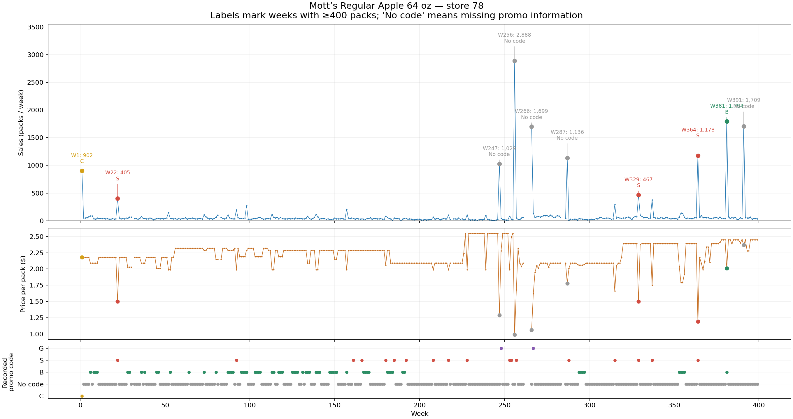
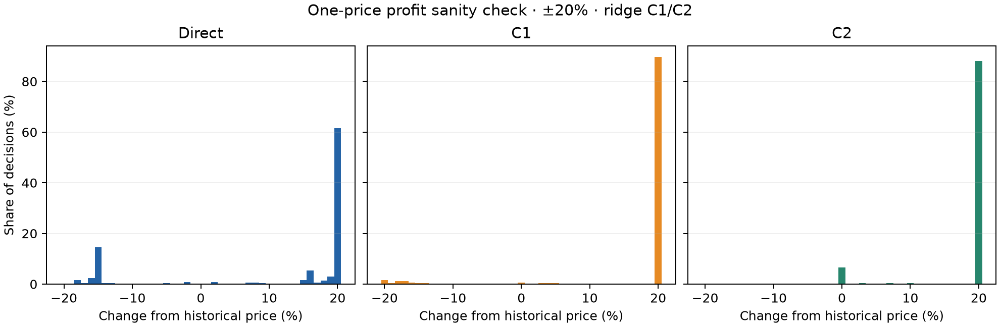
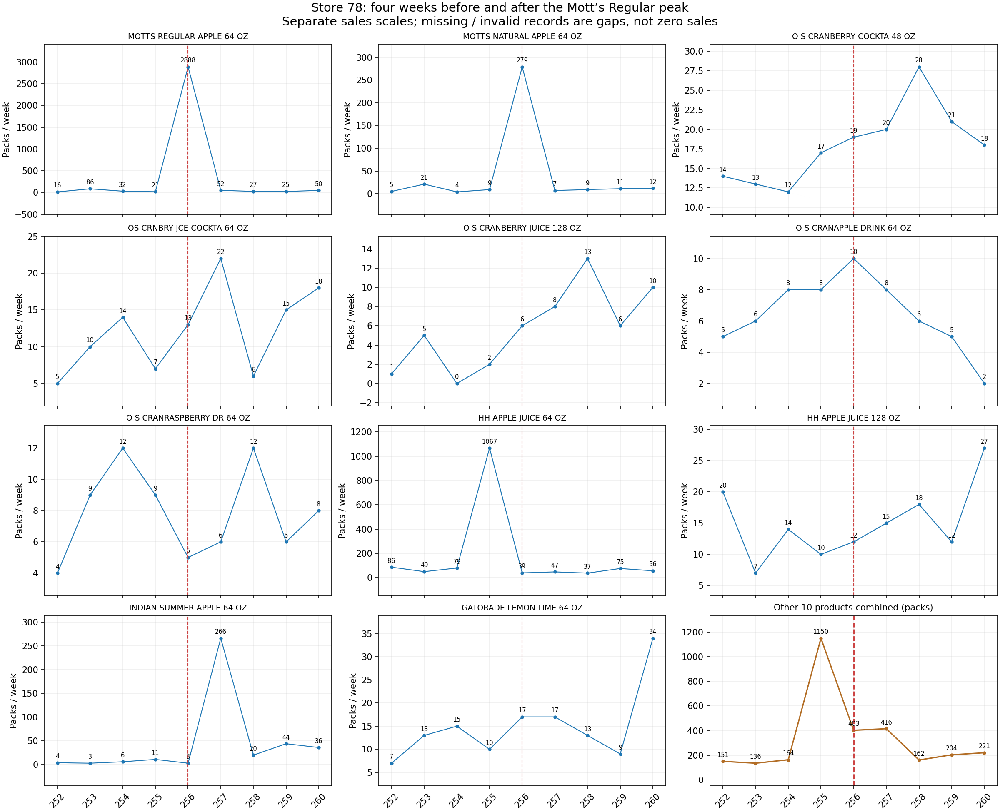
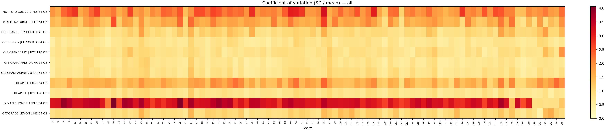
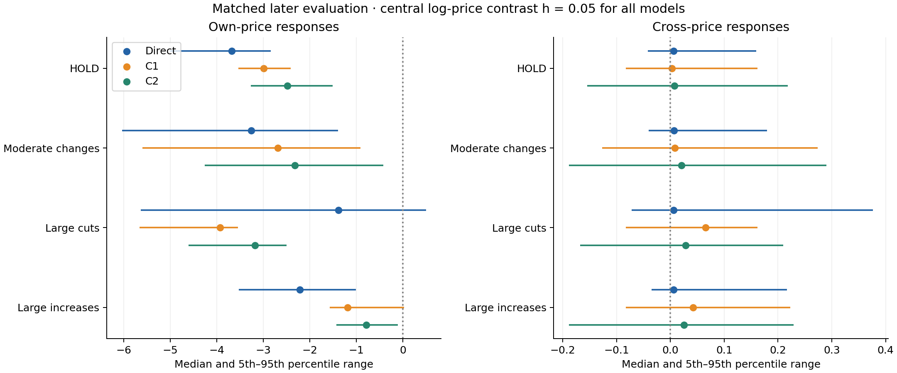
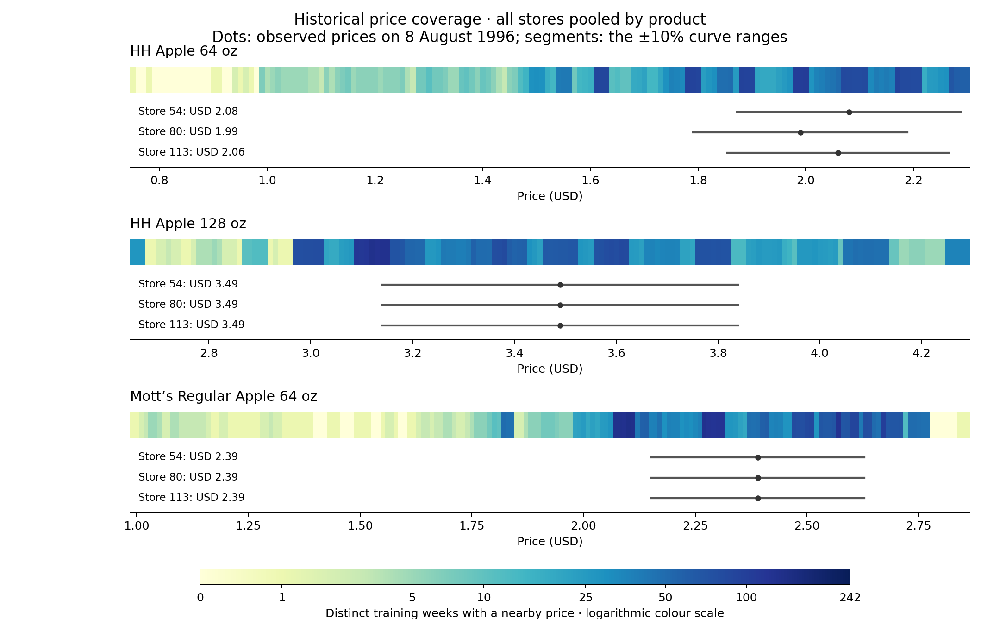
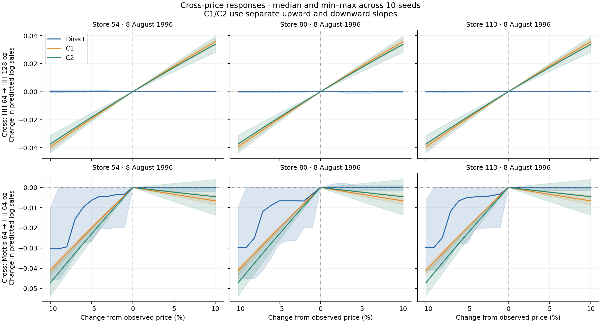

# Part I — Historical demand and price responses

This project was developed in collaboration with OpenAI Codex.

## Motivation and objective

This self-directed project extends the familiar demand-model-plus-price-optimization approach. The goal was to deepen my understanding of retail pricing by examining how price responses are estimated from historical data, how modelling choices affect them, and what limits their use in pricing decisions.

We model several products jointly through a shared demand system. A flexible demand model may forecast well without providing a stable or economically plausible response when only prices change. We investigate this concern and compare it with a decomposition that gives explicit control over the price component.

The comparison addresses two separate questions: how well the models forecast observed demand, and how their predictions respond to price changes. A simpler response surface is a modelling restriction, not evidence of more accurate causal effects.

## What we did and found

- **Compared three demand models for 11 products:** a shared CatBoost (Direct), a baseline-plus-price correction (C1), and a residualized price-response model (C2), motivated by Double Machine Learning. Both anchored models use ridge-estimated contextual own-price coefficients and constant cross-price coefficients.
- **Checked forecasts on later weeks.** Direct was most accurate in the later comparison; C1 was close, while C2 gave up more forecast accuracy. Large discounts and sales peaks remained difficult to predict.
- **Examined price-response curves and ten training seeds.** Both anchored models had lower median own-response variation than Direct. Cross-response results were mixed for C2. Neural alternatives were less repeatable or less accurate. Stability did not establish causal accuracy.
- **Audited the data and price coverage.** Missing stock and promotion information, incomplete price vectors, and coordinated price changes limited what we could learn about separate price effects.
- **Used profit optimization as a sanity check.** Strong preferences for price bounds and large predicted gains showed why acceptable forecast accuracy alone was not enough to trust price recommendations.

The main result is a comparison of forecast quality and price-response behaviour, not a validated pricing policy. The next stage will use a consumer simulator to collect controlled price data and test policies against a known demand mechanism.

## Data: what happens before modelling

- Dominick's weekly scanner data: 11 juice products, 93 stores, weeks 1–399; 357,051 valid records, including 12,925 zero-sales rows.
- Forecasting uses positive prices and sales. We exclude zeros because we cannot distinguish no demand from no available stock. Model comparisons also require complete price vectors.
- Weekly changes use adjacent calendar weeks only.

Mott's Regular sales jump from 21 to 2,888 packs as price falls from $2.55 to $0.99, with no recorded promotion code. Missing campaign or stock information makes such peaks hard to explain; an empty code does not mean there was no promotion.

Further checks found substantial sales variability and uneven complete-vector coverage. Store 88, for example, had only one evaluated week in an earlier error comparison despite long individual product histories. Store rankings therefore need sample counts alongside errors.

[Detailed data checks and figures](#appendix-a-additional-data-checks).

### Information missing from our modelling inputs

| Missing or incomplete information | Why it matters |
|---|---|
| Inventory, deliveries, shelf availability | Sales may be limited by availability; replenishment can coincide with promotion |
| Full advertising, displays and campaign terms | A price cut can arrive with a separate demand shock |
| Verified advance promotion plans | Target-week codes are used as proxies, not proven decision-time plans |
| Manager forecasts and pricing rules | Prices may respond to expected demand that we cannot observe |
| Full assortment, outside competitors, customer baskets | Switching and complementary purchases are only partly observed |
| Within-week transactions and price timing | Weekly aggregates hide timing and differing purchase conditions |
| Verified procurement costs and supplier funding | Reconstructed margins need not equal the true incremental economics |

Store traffic is not used in our model; the source collection has a separate customer-count file. “Not used” should not be confused with “unavailable anywhere.” The source project also included randomized experiments; their assignment is not reconstructed here.

## Notation

Let $n$ index store-week observations, $i$ denote the product whose demand we predict, and $K$ the number of products. Write $Y_{ni}=\log Q_{ni}$ for log sales and $X_n$ for decision context. Product identity enters the shared demand functions explicitly.

For product $j$ in observation $n$, $p_{nj}$ is the observed price and $p_{nj}^{0}$ is the preceding-week reference price. We write $\mathbf p=(p_1,\ldots,p_K)$ for a price vector under consideration; $p_j$ is its price for product $j$. This vector may contain historical prices or prices chosen for a what-if scenario.

The observed and scenario log-price changes are, respectively,

$$
D_{nj}=\log\frac{p_{nj}}{p_{nj}^{0}},
\qquad
d_{nj}(\mathbf p)=\log\frac{p_j}{p_{nj}^{0}}.
$$

Their vectors across products are $\mathbf D_n$ and $\mathbf d_n(\mathbf p)$, respectively. Both use the same reference prices, so $\mathbf d_n(\mathbf p_n)=\mathbf D_n$ at the observed price vector $\mathbf p_n=(p_{n1},\ldots,p_{nK})$.

In population equations, we omit $n$: $Y_i$, $X$ and $\mathbf D$ are random variables for log sales, context and historical price actions. Lowercase $\mathbf d$ denotes a specified value of the action vector, whether observed or chosen for a scenario. Thus $\mathbf D$ appears in expectations and data-generating equations as well as fitting objectives; $\mathbf d$ appears when evaluating a response at given prices. Neither denotes a predicted price.

## 1. Direct demand modelling

We first model log demand as a shared function of product identity, context and the full price vector:

$$
f_D(i,X_n,\mathbf p).
$$

We estimate this function by minimizing prediction error at historical prices:

$$
\widehat f_D
=
\arg\min_f\sum_{n,i}
\left[Y_{ni}-f(i,X_n,\mathbf p_n)\right]^2.
$$

We use CatBoost to capture nonlinear relationships and interactions in tabular data, including categorical product and store identifiers. This model is the forecasting benchmark and also provides a price-response surface for comparison.

## 2. Anchored demand modelling

We separate reference demand from the price response so that we can control the complexity of the price component. We allow different responses to increases and cuts: one common slope may be too restrictive. This is a piecewise-linear specification, related to asymmetric reference-price models used in retail demand studies ([Aschersleben and Steiner, 2022](https://link.springer.com/article/10.1007/s11573-022-01083-y)). It does not assume that either direction must have a stronger effect.

C1 fits the price component to reference-model errors. C2 first removes predictable context variation from demand and price actions. Both use the same response structure.

### A. Demand decomposition

Split each specified log-price action into positive and negative parts, component by component:

$$
\mathbf d^+=\max(\mathbf d,0),\qquad
\mathbf d^-=\min(\mathbf d,0).
$$

The same split defines $\mathbf D^+$ and $\mathbf D^-$ for random actions, and $\mathbf D_n^+$ and $\mathbf D_n^-$ for observed actions. We define the response function at supplied prices as

$$
f_A(i,X_n,\mathbf p)
=b(i,X_n)+T_i^+(X_n)\mathbf d_n^+(\mathbf p)
+T_i^-(X_n)\mathbf d_n^-(\mathbf p).
$$

Here, $b$ models reference log demand when all prices remain unchanged. The two $K\times K$ matrices $T^+$ and $T^-$ describe upward and downward price responses. Diagonal entries are own-price responses; off-diagonal entries are cross-price responses.

At reference prices, both actions are zero and $f_A=b$. Holding context fixed,

$$
\frac{\partial f_A}{\partial\log p_j}
=\begin{cases}
T^+_{ij}(X), & d_j>0,\\
T^-_{ij}(X), & d_j<0.
\end{cases}
$$

The function is continuous. At $d_j=0$, there are two one-sided slopes unless they coincide. Each branch is linear in log-price changes. The split is relative to the preceding-week price, not necessarily the observed price used as the centre of a plotted curve.

### B. Modelling reference demand

We use historical information and calendar features, excluding target-week prices and promotions. Ideally, the training sample would have an unchanged price vector. Since these observations are limited, we use a set $\mathcal H$ with unchanged own price and filter out observations with large or potentially influential peer-price changes.

$$
\widehat b=\arg\min_b\sum_{(n,i)\in\mathcal H}
[Y_{ni}-b(i,X_n)]^2.
$$

A shared CatBoost estimates $b$, with product identity as an input. Filtering is used without additional observation weights. This reference level remains an approximation because other products’ prices may still change in the retained sample.

### C1. Direct correction of baseline errors

Fit the price component to what the reference model leaves unexplained:

$$
Y_{ni}-b(i,X_n)
\approx T_i^+(X_n)\mathbf D_n^+
+T_i^-(X_n)\mathbf D_n^-.
$$

Using past-only out-of-fold predictions, estimate

$$
(\widehat T^+_{\mathrm{C1}},\widehat T^-_{\mathrm{C1}})
=\arg\min_{T^+,T^-}\sum_{n,i}
\left[Y_{ni}-\widehat b^{\,\mathrm{past}}(i,X_n)
-T_i^+(X_n)\mathbf D_n^+-T_i^-(X_n)\mathbf D_n^-\right]^2
+\mathcal P(T^+,T^-).
$$

“Past” means that the prediction comes from a model trained on earlier temporal blocks. The objective improves the combined demand forecast; its correction may absorb baseline errors as well as price effects.

### C2. Separating price response from baseline correction

To estimate the response, assume the following model for sales and price actions under the historical pricing process:

$$
Y_i=g(i,X)+T_i^+(X)\mathbf D^+
+T_i^-(X)\mathbf D^-+\varepsilon_i,
\qquad E[\varepsilon_i\mid X,\mathbf D]=0.
$$

Subtracting $b$ leaves two terms: the price response and the reference-level error $g-b$. If the baseline underpredicts demand in contexts where managers tend to cut prices, C1 may attribute part of that baseline error to the price cut. C2 instead removes the demand and price actions predictable from context, then estimates how the remaining variations move together.

Define

$$
m(i,X)=E[Y_i\mid X],\qquad
\mathbf e^+(X)=E[\mathbf D^+\mid X],\qquad
\mathbf e^-(X)=E[\mathbf D^-\mid X].
$$

The function $m$ averages over all historical actions, including HOLD. Under the model above,

$$
m(i,X)=g(i,X)+T_i^+(X)\mathbf e^+(X)+T_i^-(X)\mathbf e^-(X).
$$

Subtracting this conditional mean gives

$$
Y_i-m(i,X)
=T_i^+(X)\{\mathbf D^+-\mathbf e^+(X)\}
+T_i^-(X)\{\mathbf D^--\mathbf e^-(X)\}+\varepsilon_i.
$$

Estimate the auxiliary means by squared-error regression:

$$
\widehat m=\arg\min_m\sum_{n,i}[Y_{ni}-m(i,X_n)]^2,
\qquad
(\widehat{\mathbf e}^+,\widehat{\mathbf e}^-)
=\arg\min_{\mathbf e^+,\mathbf e^-}
\sum_n\sum_{s\in\{+,-\}}\|\mathbf D_n^s-\mathbf e^s(X_n)\|_2^2.
$$

**Past-only temporal cross-fitting** trains on earlier blocks and predicts the next block, respecting the two-week label delay. It produces

$$
U_{ni}=Y_{ni}-\widehat m^{\,\mathrm{past}}(i,X_n),
\qquad
\mathbf V_n^s=\mathbf D_n^s-\widehat{\mathbf e}^{s,\mathrm{past}}(X_n),
\quad s\in\{+,-\}.
$$

Split raw actions before residualization: splitting $\mathbf D-\widehat{\mathbf e}$ by sign would define a different model. The response estimator solves

$$
(\widehat T^+_{\mathrm{C2}},\widehat T^-_{\mathrm{C2}})
=\arg\min_{T^+,T^-}\sum_{n,i}
[U_{ni}-T_i^+(X_n)\mathbf V_n^+-T_i^-(X_n)\mathbf V_n^-]^2
+\mathcal P(T^+,T^-).
$$

The two matrix-vector products predict residual log sales from residual action components across products. The penalty limits coefficient size and contextual variation.

This follows the residualization principle of [Double Machine Learning](https://arxiv.org/abs/1608.00060) and the residual-loss formulation of the [R-learner](https://arxiv.org/abs/1712.04912), applied here to transformed continuous actions. [EconML](https://www.pywhy.org/EconML/spec/estimation/dml.html) describes this general treatment-feature approach. Orthogonality can reduce sensitivity to auxiliary-model errors under suitable assumptions; it does not remove unobserved confounding. Temporal dependence, limited price variation and our anchor approximation remain separate concerns.

### D. Connecting response to reference demand

For a specified action vector $\mathbf d$, the residual model implies

$$
E[Y_i\mid X,\mathbf D=\mathbf d]
=m(i,X)+\sum_{s\in\{+,-\}}T_i^s(X)\{\mathbf d^s-\mathbf e^s(X)\}
=g(i,X)+\sum_{s\in\{+,-\}}T_i^s(X)\mathbf d^s,
$$

where

$$
g(i,X)=m(i,X)-T_i^+(X)\mathbf e^+(X)-T_i^-(X)\mathbf e^-(X).
$$

The residual fit identifies a slope around the historical-policy average. Subtracting the expected price contribution gives the implied unchanged-price level $g$. Our forecast uses the separately fitted $b$ for this level, requiring the additional approximation $b\approx g$. Both estimators therefore forecast

$$
\widehat f_{\mathrm Ck}(i,X_n,\mathbf p)
=\widehat b(i,X_n)+\sum_{s\in\{+,-\}}
\widehat T_{\mathrm Ck,i}^{s}(X_n)\mathbf d_n^{s}(\mathbf p),
\qquad k\in\{1,2\}.
$$

C1 learns a price correction from the errors of $b$, so it can absorb both price effects and baseline errors. C2 estimates the price response after removing context-predictable variation from sales and price changes, then adds this response to $b$.

### E. Restricting and regularizing the matrices

Two fully contextual matrices would require $2K^2$ response functions. Price variation is too limited to estimate all of them flexibly. For each direction, we use contextual own effects and constant cross coefficients:

$$
T^s_{ij}(X)=\begin{cases}
a_i^s+h_i^s(X),&i=j,\\
c_{ij}^s,&i\ne j,
\end{cases}
\qquad s\in\{+,-\}.
$$

The functions $h_i^s$ are linear in selected context features and centered store indicators. Cross coefficients pool observations across stores and weeks, separately by direction; they need not be reciprocal. We estimate all these coefficients jointly by structured ridge regression using the C1 or C2 loss.

Write $T^+=A+H$ and $T^-=A-H$, and use

$$
\mathcal P(T^+,T^-)=\mathcal P_0(A)+\mathcal P_0(H).
$$

Here $\mathcal P_0$ is a weighted ridge penalty on own, cross, context and store coefficients. Penalizing $H$ shrinks the two branches toward a common response. The deviation multiplier is fixed at 1. C1 and C2 have identical nominal penalties, but their action scales differ, so effective shrinkage differs too.

Ridge is the main specification. [Neural alternatives](#appendix-f-neural-response-experiments) test a nonlinear own-price function and a fully contextual response matrix.

### F. Algorithms and inputs

| Component | Approximation and inputs |
|---|---|
| $b$ | Shared CatBoost; product/store identity, calendar and historical prices, sales and promotions; no target-week prices or promotions |
| $m$ | Shared CatBoost; agreed conditioning context, including permitted planned-promotion proxies; no target price actions |
| $(\mathbf e^+,\mathbf e^-)$ | One 22-output neural network with 64 hidden units; same conditioning context, categorical store encoding and historical inner early stopping |
| $(T^+,T^-)$ | Structured ridge regression; linear own-context terms and centered store effects; constant cross coefficients within each branch |

CatBoost captures nonlinear tabular relationships. The price network shares information across outputs, but estimates means rather than a joint assignment distribution. Structured ridge keeps the response component interpretable and limits its flexibility. Its eight numerical inputs are calendar sine/cosine, the existing own promotion and reference-price features, and four lagged price-context features. Median imputation and standardization are fitted on training rows only.

All historical features respect decision time. Realized target-week promotion codes are proxies for known plans. In the price-response block, permitted promotion information modifies the own-price slope rather than adding a separate demand-level effect.

## 3. Forecasting results

All models are evaluated on identical observations within each temporal block. The main metric is

$$
\operatorname{logRMSE}=\sqrt{\frac1N\sum_{n,i}(Y_{ni}-\widehat Y_{ni})^2}.
$$

N is the number of evaluated product–store–week rows. Lower is better; this is not a percentage error. These tables use the retained single fits; the stability analysis separately summarizes ten training runs.

| Model | Selection | Development | Later evaluation |
|---|---|---|---|
| Direct | 0.5547 | 0.4852 | 0.4907 |
| C1 | 0.6534 | 0.4843 | 0.4941 |
| C2 | 0.6394 | 0.4945 | 0.5099 |

Direct is best in the selection and later periods; C1 is slightly better in development. In the later period, C1 and C2 have 0.7% and 3.9% higher logRMSE than Direct. Forecast accuracy does not establish accurate price effects.

All predictions are temporal out of sample, but the later period was repeatedly inspected during development. It is not an untouched final test. The asymmetry decision was also informed by these results.

### Errors by price change

*Five-percentage-point intervals; HOLD is separate, with three dots offset horizontally for readability. Hollow markers indicate fewer than 30 rows. The lower panel gives counts. The main view covers −55% to +55%; 169 rows (1.0%) fall outside it.*

C1/C2 perform well on own-HOLD rows, where peer prices can still change. Direct has lower error on moderate changes, deep cuts and large increases in these retained fits. C2 still has substantial discount errors.

Earlier peak checks found large discounts near Memorial Day and Labor Day. Such weeks combine price changes with potentially missing campaign conditions. Each directional branch still has a constant log-price slope at fixed context, which limits how well the models can represent deep discounts.

## 4. Evaluation coverage

The models require a complete price-action vector for the selected products. Missing prices are not treated as unchanged prices.

| Period | Eligible outcome rows | Evaluated rows | Evaluated store-weeks |
|---|---:|---:|---:|
| Selection | 38,958 | 28,336 | 2,576 |
| Development | 45,063 | 39,512 | 3,592 |
| Later evaluation | 39,986 | 16,764 | 1,524 |

The later comparison covers 28 of the 52 planned weeks. Its results describe the observed, complete-price subset rather than the full store assortment.

The demand model is conditional on positive observed price and sales. It does not model availability, stockouts, assortment entry or the extensive margin. Missing observations alone cannot tell us which of these mechanisms occurred.

## 5. Price responses: matched evaluation

We distinguish **demand forecast accuracy, price-response accuracy, and model stability and plausibility**. Historical outcomes let us assess forecasting and repeatability; without additional identifying evidence, they do not directly validate counterfactual price responses. Our concern is that a flexible demand model may forecast well but respond inconsistently to price probes or retraining. We compare it with a restricted price component, without treating imposed smoothness as evidence of causal accuracy.

### Own-price curves

Three products and three stores are shown in the same week, selected without inspecting responses. One price varies by ±10% around its observed value, with context and other prices fixed. Lines show medians over ten seeds; bands are pointwise min–max ranges.

C1/C2 have straight segments within each direction. Their coefficients change across contexts, but remain constant along a fixed-context branch. The bands show how those estimated slopes change across training runs. Individual historical price coverage does not guarantee comparable promotion and peer-price contexts.

The anchored kink is defined by the preceding-week reference price. Each curve is centred on its prediction at the observed price, so passing through zero is automatic.

### Repeatability and cross-price responses

Mean logRMSE over ten runs is **0.4908 / 0.4935 / 0.5074** for Direct / C1 / C2.

- Median own-response SD is **0.2801 / 0.0292 / 0.1195**. Both anchored models are more repeatable on this measure.
- Material own-response sign reversals occur in **0.86% / 0.09% / 0.02%** of matched entries.
- Cross-response results are mixed: C1 is more repeatable, while C2 has higher median SD than Direct but a lower P90.
- Shared cross coefficients impose stability across contexts. Repeated training checks whether their estimated values remain consistent. Seed spread is not causal uncertainty.

All models use matched contexts and price intervals. Direct responses use finite differences; C1/C2 use the equivalent contrasts from their two branches.

[Distributions, sign reversals, context groups, cross-price curves and sensitivity checks](#appendix-b-response-distributions).

## 6. Optimization sanity checks

We predict units from log sales using frozen historical conversion factors, then calculate gross profit:

$$\widehat\Pi(\mathbf p)=\sum_i(p_i-\widehat c_i)\widehat Q_i(\mathbf p).$$

Purchase-cost proxies use past price/margin records. Synthetic sales caps use the mean of the largest 10% of training sales for each SKU. These are experimental constraints, not observed inventory. Operating costs and many supplier terms are absent.

### Where does the optimizer go?

Change one SKU at a time by up to ±20% around its historical price; keep other prices and context at their historical values. Use the same 1-percentage-point grid, cent rounding, cost floor and synthetic sales caps for all models. Include focal-product observations whose historical price change was between −25% and +50%: 16,183 feasible decisions per model. This ex-post cohort is a diagnostic, not a deployable policy rule.

| Model | At upper price bound | At lower price bound |
|---|---|---|
| Direct | 61.6% | 0.1% |
| C1 | 89.6% | 1.5% |
| C2 | 88.0% | 0.1% |

The upper-bound preference remains strong for both anchored models. These are independent one-product alternatives; profits cannot be summed across them as if they formed a joint policy. The exercise does not validate the projected gains.

[Optimization protocol](#appendix-e-optimization-diagnostics).

### Do unit forecasts reproduce historical sales?

At the actual historical prices, the models predict the following total sales on the same 16,764 rows.

| Model | Actual units | Predicted units | Total bias | Rows overpredicted by >50% |
|---|---|---|---|---|
| Direct | 547,654 | 566,834 | +3.5% | 26.8% |
| C1 | 547,654 | 593,402 | +8.4% | 24.0% |
| C2 | 547,654 | 501,995 | -8.3% | 24.5% |

C2 overpredicts some rows while underpredicting total sales because missed large peaks dominate the total. These errors already exist at observed prices and carry into profit calculations. Without inventory records, we cannot attribute overprediction to stockouts.

## 7. What worked, what did not

**Useful outcomes**

- A shared 11-product demand benchmark and explicit own/cross-response models.
- Saved forecast and stability results, with portable response-fitting code. The full raw-data pipeline is not packaged.
- Clear examples of promotion peaks, sample selection and missing operational information.
- A concrete distinction between estimating sales, describing price response and evaluating a policy.

**Unresolved**

- No validated causal price response or deployable policy.
- No reliable reconstruction of inventory or stockouts.
- An approximate HOLD anchor and incomplete target-week promotion information.
- Strong optimizer boundary preferences with the current ridge response models.
- No untouched final evaluation left after repeated exploration.
- No completed cross-category replication; cereals remains a possible future check.

## 8. Why the next stage is a simulator

Use a known demand mechanism to separate model error from missing counterfactual evidence. Start simply, roughly calibrate scales, then compare experiment lengths, price ranges and adaptive learning. Evaluate policies on new simulated periods, including the cost of exploration. Conclusions will be conditional on the simulator.

See [the roadmap](roadmap.md). Simulator implementation and bandit results are not part of this release.

## Sources

- [Dominick's dataset, Kilts Center](https://www.chicagobooth.edu/research/kilts/research-data/dominicks). We acknowledge the Kilts Center for Marketing at the University of Chicago Booth School of Business.
- [Chernozhukov et al., Double/Debiased Machine Learning](https://arxiv.org/abs/1608.00060).
- [Nie and Wager, Quasi-Oracle Estimation / R-learner](https://arxiv.org/abs/1712.04912).
- [TabPack implementation, Yandex Research](https://github.com/yandex-research/tabpack).

## Appendix A. Additional data checks

Discounts and sales peaks move between products over neighbouring weeks. This makes a single-product before/after comparison difficult to interpret.

Median coefficient of variation across product–store histories is 0.94. The median maximum/minimum-positive sales ratio is 88, although one-unit weeks make that ratio sensitive to small denominators.

## Appendix B. Response distributions

Groups refer to the outcome product’s observed price change. HOLD means unchanged own price; moderate changes are nonzero changes within ±20%; large cuts and increases fall outside that range. Peer prices may change in every group.

Dots show medians; lines span the 5th–95th percentiles across matched observations. Responses use a central log-price step of 0.05. These ranges describe heterogeneity across observations.

Training prices are pooled across stores. Colour counts distinct weeks within about 1% of each price. Dots mark example prices and segments show their ±10% ranges. Observed individual price levels do not establish support for the joint price vector.

## Appendix C. Stability by historical price-change group

For each matched response, calculate its standard deviation across ten seeds. The table summarizes these SDs. A material sign reversal means an entry falls below −0.1 in one run and above +0.1 in another.

| Group | Model | Own median SD | Own reversals (%) | Cross median SD | Cross reversals (%) |
|---|---|---|---|---|---|
| HOLD | Direct | 0.2750 | 0.00 | 0.0187 | 0.63 |
| HOLD | C1 | 0.0280 | 0.00 | 0.0053 | 0.00 |
| HOLD | C2 | 0.1207 | 0.00 | 0.0259 | 0.00 |
| Moderate changes | Direct | 0.3194 | 0.42 | 0.0230 | 3.17 |
| Moderate changes | C1 | 0.0422 | 0.17 | 0.0058 | 0.00 |
| Moderate changes | C2 | 0.1180 | 0.00 | 0.0281 | 0.00 |
| Large cuts | Direct | 0.4062 | 20.41 | 0.0192 | 11.27 |
| Large cuts | C1 | 0.0188 | 0.00 | 0.0065 | 0.00 |
| Large cuts | C2 | 0.0576 | 0.00 | 0.0312 | 0.00 |
| Large increases | Direct | 0.2512 | 1.95 | 0.0255 | 1.46 |
| Large increases | C1 | 0.0705 | 1.39 | 0.0068 | 0.00 |
| Large increases | C2 | 0.1296 | 0.42 | 0.0312 | 0.00 |

### Directional branches

| Model | Response | Median SD | P90 SD | Reversals (%) |
|---|---|---|---|---|
| C1_plus | Own | 0.0539 | 0.0851 | 0.54 |
| C1_plus | Cross | 0.0089 | 0.0158 | 0.00 |
| C1_minus | Own | 0.0218 | 0.0473 | 0.00 |
| C1_minus | Cross | 0.0079 | 0.0182 | 0.00 |
| C2_plus | Own | 0.1993 | 0.2754 | 0.07 |
| C2_plus | Cross | 0.0404 | 0.0635 | 0.00 |
| C2_minus | Own | 0.0812 | 0.1298 | 0.00 |
| C2_minus | Cross | 0.0299 | 0.0575 | 0.91 |

These branches are evaluated for the same contexts, whether or not that action direction occurred. They are not screened for directional support. The central-contrast results should be read alongside them.

## Appendix D. Cross-price examples

For HH 64 to HH 128 oz, Direct is almost flat while C1/C2 show a positive cross response. For Mott’s to HH 64 oz, the anchored response differs by direction: a Mott’s cut lowers predicted HH sales, while a Mott’s increase produces a much smaller, slightly negative median adjustment. That asymmetry is a model result, not proof of substitution or complementarity.

The anchored cross curves repeat here because coefficients are shared and the selected stores use the same branch throughout each segment. In other contexts, branch selection or crossing can differ. Store histories and promotions may also differ; comparing columns does not isolate a causal store effect. Bands are pointwise ranges over seeds, not confidence intervals for true effects.

## Appendix E. Optimization diagnostics

- Main fits and the same complete later-period contexts as the forecast comparison; no moderate-only refit.
- One product changes at a time, around its historical price; peers stay historical. The focal-product historical-change filter is [−25%, +50%].
- Candidate grid: ±20% in 1-percentage-point increments, cent rounded, plus exact feasible endpoints and the historical price. Ties choose the closest price to history.
- Purchase-cost floor: past price/margin proxies. Sales cap: mean of the largest 10% of training sales by SKU. Neither is observed inventory or verified procurement cost.
- Unit-conversion factors are estimated by the same method for each current model from weeks 334–346, then frozen. Direct scores are reused only after checking unchanged models, conversion factors and candidate grids.
- Historical-sales calibration is uncapped; optimization quantities are capped. Each scenario maximizes estimated category gross profit, not observed profit.

## Appendix F. Neural response experiments

We kept B, m, E, the temporal splits and evaluation rows unchanged and tested two alternatives with TabPack:

- **Neural diagonal:** a shared network predicts the two own-price coefficients. Cross coefficients retain their fitted ridge values. This isolates the own-function replacement, with different regularization and early stopping.
- **Full neural matrix:** a shared network receives context and product identity and outputs 22 coefficients: 11 for increases and 11 for cuts. Stacking products gives two context-dependent matrices. This changes both the estimator and the constant-cross restriction.

Both use the same C1 or C2 response loss. The full-matrix model is still linear in each directional log-price action at fixed context; it does not learn an unrestricted nonlinear price curve. Four width-128 MLPs, temporal early stopping and checkpoint ensembling are used in each experiment.

| Model | Response estimator | Selection RMSE | Development RMSE | Later RMSE | Own median seed SD |
|---|---|---|---|---|---|
| C1 | Ridge | 0.6534 | 0.4843 | 0.4941 | 0.0292 |
| C1 | Neural diagonal | 0.6508 | 0.4886 | 0.4910 | 0.2082 |
| C1 | Full neural matrix | 0.7076 | 0.4976 | 0.5074 | Not tested |
| C2 | Ridge | 0.6394 | 0.4945 | 0.5099 | 0.1195 |
| C2 | Neural diagonal | 0.6228 | 0.4891 | 0.5088 | 0.2723 |
| C2 | Full neural matrix | 0.7133 | 0.5299 | 0.5279 | Not tested |

Neural diagonals slightly improve later-period forecasts, but greatly increase own-response seed variation. Full neural matrices have worse forecast accuracy than ridge in all three periods for both C1 and C2. Their results use one seed; they are not a stability comparison. The larger function class also makes it harder to separate own and cross effects when prices move together.

We retain ridge as the main model because it provides a simpler, more repeatable response component with similar forecast accuracy. These experiments do not establish causal accuracy for any specification.
