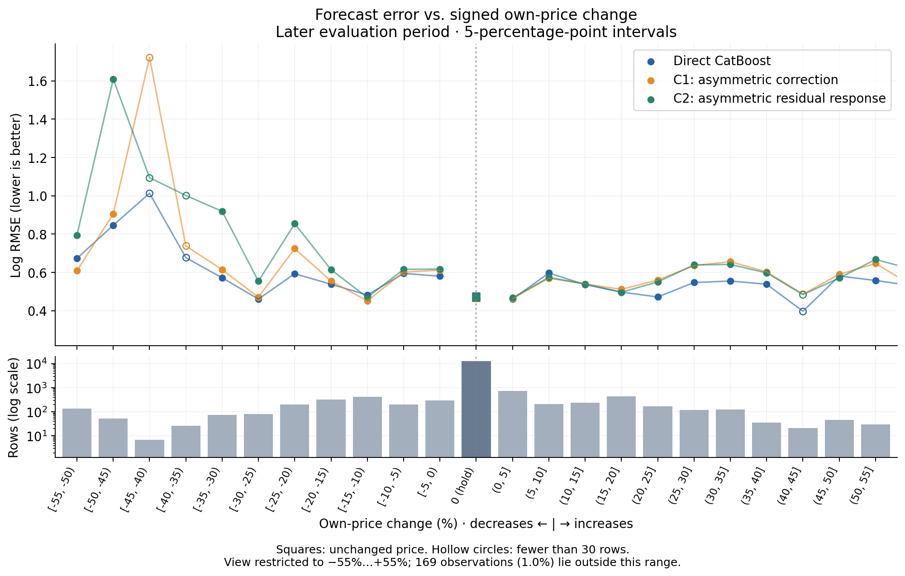
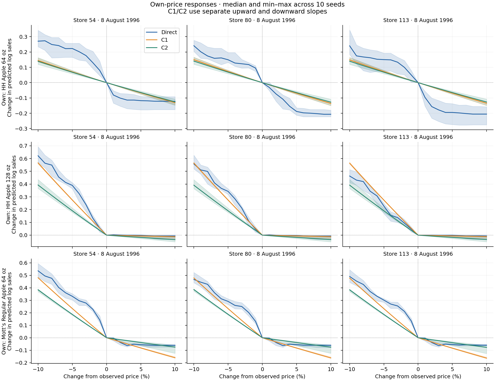
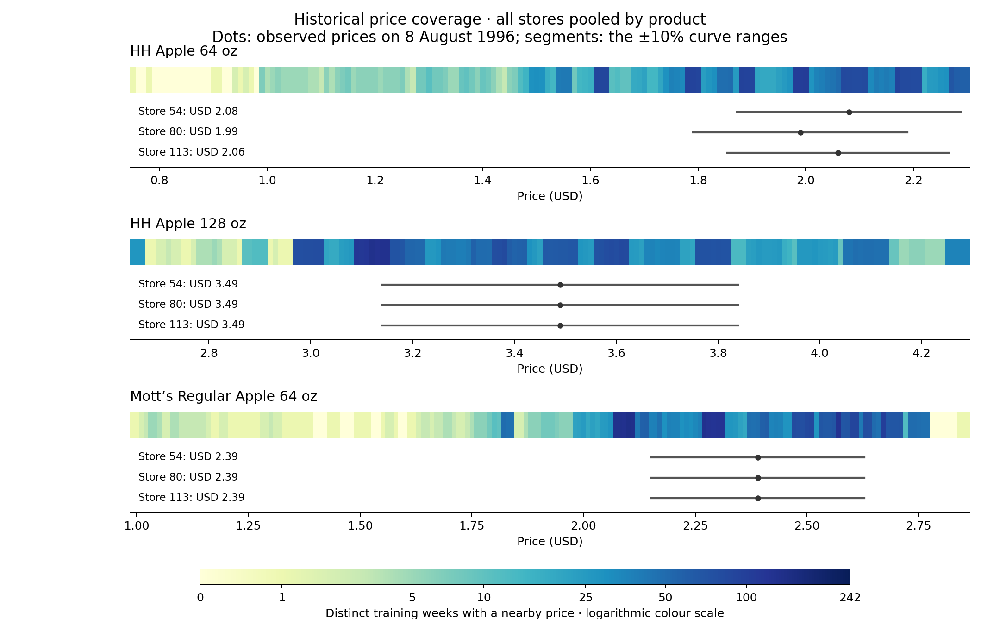
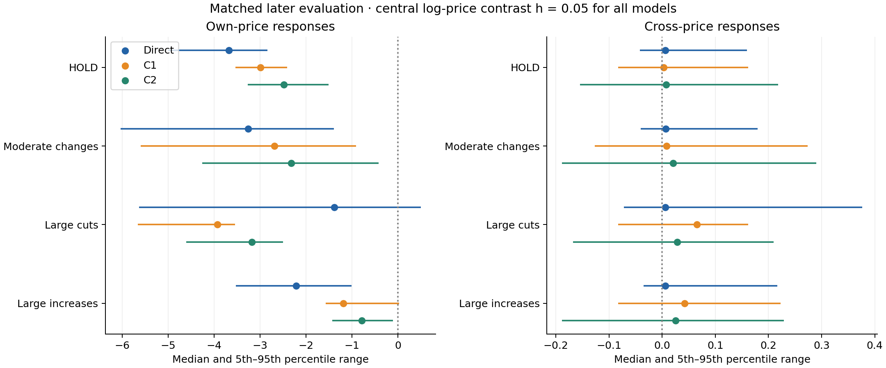
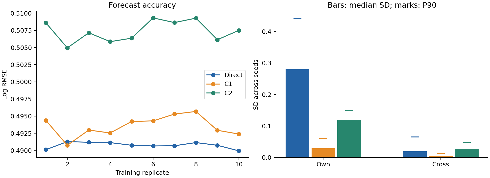
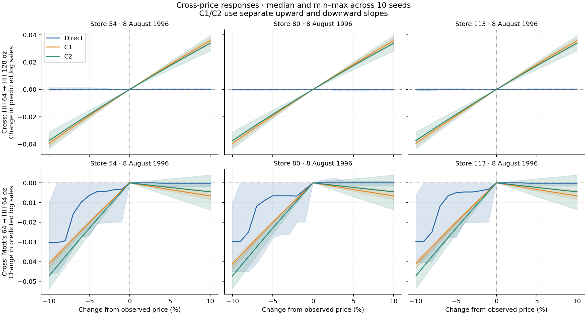
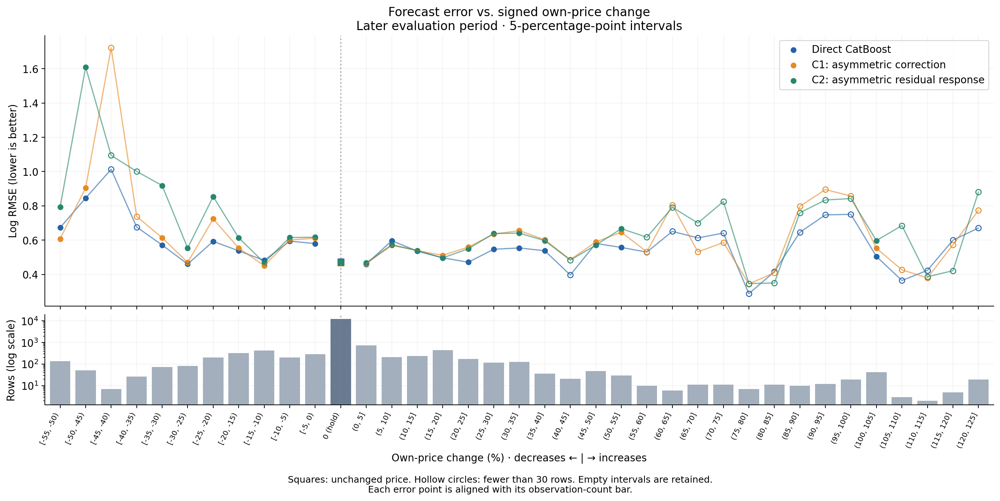

# Technical appendix: fixed historical models

*Detailed tables for the retained Direct and asymmetric C1/C2 fits. Later exploratory optimization and data analysis are summarized in [Part I](part_1_historical_data.md). No deployed policy is claimed.*

## Motivation and objective

This self-directed project extends the familiar demand-model-plus-price-optimization approach. The goal was to deepen my understanding of retail pricing by examining how price responses are estimated from historical data, how modelling choices affect them, and what limits their use in pricing decisions.

We model several products jointly through a shared demand system. A flexible demand model may forecast well without providing a stable or economically plausible response when only prices change. We investigate this concern and compare it with a decomposition that gives explicit control over the price component.

The comparison addresses two separate questions: how well the models forecast observed demand, and how their predictions respond to price changes. A simpler response surface is a modelling restriction, not evidence of more accurate causal effects.

## Data and notation

We use weekly Dominick’s Finer Foods data, with Bottled Juices (BJC) as the main category. Cereals (CER) is reserved for a later cross-category check; that check is not part of the results below. The final comparison uses 11 selected BJC products.

The data contain observed prices, sales, promotion codes, product identifiers and store information. They do not provide a complete operational view of inventory, stockouts, advertising and display activity, advance promotion plans, or the information used by price managers.

Let \(n\) index store-week observations, \(i\) denote the product whose demand we predict, and \(K\) the number of products. Write \(Y_{ni}=\log Q_{ni}\) for log sales and \(X_n\) for decision context. Product identity enters the shared demand functions explicitly.

For product \(j\), the observed action and the action for a price vector \(\mathbf p\) are

\[
D_{nj}=\log\frac{p_{nj}}{p_{nj}^{0}},
\qquad
d_{nj}(\mathbf p)=\log\frac{p_j}{p_{nj}^{0}},
\]

where \(p_{nj}^{0}\) is the preceding-week reference price. The vectors \(\mathbf D_n\) and \(\mathbf d_n(\mathbf p)\) collect actions across products. At observed prices, \(\mathbf d_n(\mathbf p_n)=\mathbf D_n\).

## 1. Direct demand modelling

We first model log demand as a shared function of product identity, context and the full price vector:

\[
f_D(i,X_n,\mathbf p).
\]

We estimate this function by minimizing prediction error at historical prices:

\[
\widehat f_D
=
\arg\min_f\sum_{n,i}
\left[Y_{ni}-f(i,X_n,\mathbf p_n)\right]^2.
\]

We use CatBoost to capture nonlinear relationships and interactions in tabular data, including categorical product and store identifiers. This model is the forecasting benchmark and also provides a price-response surface for comparison.

## 2. Anchored demand modelling

We separate reference demand from the price response so that we can control the complexity of the price component. We allow different responses to increases and cuts: one common slope may be too restrictive. This is a piecewise-linear specification, related to asymmetric reference-price models used in retail demand studies ([Aschersleben and Steiner, 2022](https://link.springer.com/article/10.1007/s11573-022-01083-y)). It does not assume that either direction must have a stronger effect.

C1 fits the price component to reference-model errors. C2 first removes predictable context variation from demand and price actions. Both use the same response structure.

### A. Demand decomposition

Split each log-price action into positive and negative parts, component by component:

\[
\mathbf d^+=\max(\mathbf d,0),\qquad
\mathbf d^-=\min(\mathbf d,0).
\]

We define

\[
f_A(i,X_n,\mathbf p)
=b(i,X_n)+T_i^+(X_n)\mathbf d_n^+(\mathbf p)
+T_i^-(X_n)\mathbf d_n^-(\mathbf p).
\]

Here, \(b\) models reference log demand when all prices remain unchanged. The two \(K\times K\) matrices \(T^+\) and \(T^-\) describe upward and downward price responses. Diagonal entries are own-price responses; off-diagonal entries are cross-price responses.

At reference prices, both actions are zero and \(f_A=b\). Holding context fixed,

\[
\frac{\partial f_A}{\partial\log p_j}
=\begin{cases}
T^+_{ij}(X), & d_j>0,\\
T^-_{ij}(X), & d_j<0.
\end{cases}
\]

The function is continuous. At \(d_j=0\), there are two one-sided slopes unless they coincide. Each branch is linear in log-price changes. The split is relative to the preceding-week price, not necessarily the observed price used as the centre of a plotted curve.

### B. Modelling reference demand

We use historical information and calendar features, excluding target-week prices and promotions. Ideally, the training sample would have an unchanged price vector. Since these observations are limited, we use a set \(\mathcal H\) with unchanged own price and filter out observations with large or potentially influential peer-price changes.

\[
\widehat b=\arg\min_b\sum_{(n,i)\in\mathcal H}
[Y_{ni}-b(i,X_n)]^2.
\]

A shared CatBoost estimates \(b\), with product identity as an input. Filtering is used without additional observation weights. This reference level remains an approximation because other products’ prices may still change in the retained sample.

### C1. Direct correction of baseline errors

Fit the price component to what the reference model leaves unexplained:

\[
Y_{ni}-b(i,X_n)
\approx T_i^+(X_n)\mathbf D_n^+
+T_i^-(X_n)\mathbf D_n^-.
\]

Using past-only out-of-fold predictions, estimate

\[
(\widehat T^+_{\mathrm{C1}},\widehat T^-_{\mathrm{C1}})
=\arg\min_{T^+,T^-}\sum_{n,i}
\left[Y_{ni}-\widehat b^{\,\mathrm{past}}(i,X_n)
-T_i^+(X_n)\mathbf D_n^+-T_i^-(X_n)\mathbf D_n^-\right]^2
+\mathcal P(T^+,T^-).
\]

“Past” means that the prediction comes from a model trained on earlier temporal blocks. The objective improves the combined demand forecast; its correction may absorb baseline errors as well as price effects.

### C2. Separating price response from baseline correction

Suppose the conditional demand model is

\[
Y_i=g(i,X)+T_i^+(X)\mathbf D^+
+T_i^-(X)\mathbf D^-+\varepsilon_i,
\qquad E[\varepsilon_i\mid X,\mathbf D]=0.
\]

Then subtracting \(b\) leaves both the price component and the reference-level error \(g-b\). If that error is associated with price actions, C1 can absorb it into its slopes. C2 instead compares demand and actions with their historical-policy averages.

Define

\[
m(i,X)=E[Y_i\mid X],\qquad
\mathbf e^+(X)=E[\mathbf D^+\mid X],\qquad
\mathbf e^-(X)=E[\mathbf D^-\mid X].
\]

The function \(m\) averages over all historical actions, including HOLD. Under the model above,

\[
m(i,X)=g(i,X)+T_i^+(X)\mathbf e^+(X)+T_i^-(X)\mathbf e^-(X).
\]

Subtracting this conditional mean gives

\[
Y_i-m(i,X)
=T_i^+(X)\{\mathbf D^+-\mathbf e^+(X)\}
+T_i^-(X)\{\mathbf D^--\mathbf e^-(X)\}+\varepsilon_i.
\]

Estimate the auxiliary means by squared-error regression:

\[
\widehat m=\arg\min_m\sum_{n,i}[Y_{ni}-m(i,X_n)]^2,
\qquad
(\widehat{\mathbf e}^+,\widehat{\mathbf e}^-)
=\arg\min_{\mathbf e^+,\mathbf e^-}
\sum_n\sum_{s\in\{+,-\}}\|\mathbf D_n^s-\mathbf e^s(X_n)\|_2^2.
\]

**Past-only temporal cross-fitting** trains on earlier blocks and predicts the next block, respecting the two-week label delay. It produces

\[
U_{ni}=Y_{ni}-\widehat m^{\,\mathrm{past}}(i,X_n),
\qquad
\mathbf V_n^s=\mathbf D_n^s-\widehat{\mathbf e}^{s,\mathrm{past}}(X_n),
\quad s\in\{+,-\}.
\]

Split raw actions before residualization: splitting \(\mathbf D-\widehat{\mathbf e}\) by sign would define a different model. The response estimator solves

\[
(\widehat T^+_{\mathrm{C2}},\widehat T^-_{\mathrm{C2}})
=\arg\min_{T^+,T^-}\sum_{n,i}
[U_{ni}-T_i^+(X_n)\mathbf V_n^+-T_i^-(X_n)\mathbf V_n^-]^2
+\mathcal P(T^+,T^-).
\]

The two matrix-vector products predict residual log sales from residual action components across products. The penalty limits coefficient size and contextual variation.

This follows the residualization principle of [Double Machine Learning](https://arxiv.org/abs/1608.00060) and the residual-loss formulation of the [R-learner](https://arxiv.org/abs/1712.04912), applied here to transformed continuous actions. [EconML](https://www.pywhy.org/EconML/spec/estimation/dml.html) describes this general treatment-feature approach. Orthogonality can reduce sensitivity to auxiliary-model errors under suitable assumptions; it does not remove unobserved confounding. Temporal dependence, limited price variation and our anchor approximation remain separate concerns.

### D. Connecting response to reference demand

The residual model implies

\[
E[Y_i\mid X,\mathbf D=\mathbf d]
=m(i,X)+\sum_{s\in\{+,-\}}T_i^s(X)\{\mathbf d^s-\mathbf e^s(X)\}
=g(i,X)+\sum_{s\in\{+,-\}}T_i^s(X)\mathbf d^s,
\]

where

\[
g(i,X)=m(i,X)-T_i^+(X)\mathbf e^+(X)-T_i^-(X)\mathbf e^-(X).
\]

We replace this implied reference level with the separately fitted \(b\). This requires \(b\approx g\), an additional modelling assumption rather than a consequence of residualization. Both estimators therefore forecast

\[
\widehat f_{\mathrm Ck}(i,X_n,\mathbf p)
=\widehat b(i,X_n)+\sum_{s\in\{+,-\}}
\widehat T_{\mathrm Ck,i}^{s}(X_n)\mathbf d_n^{s}(\mathbf p),
\qquad k\in\{1,2\}.
\]

C1 targets combined forecast accuracy; C2 estimates response without using baseline residuals, then combines it with B.

### E. Restricting and regularizing the matrices

Two fully contextual matrices would require \(2K^2\) response functions. Price variation is too limited to estimate all of them flexibly. For each direction, we use contextual own effects and shared cross coefficients:

\[
T^s_{ij}(X)=\begin{cases}
a_i^s+h_i^s(X),&i=j,\\
c_{ij}^s,&i\ne j,
\end{cases}
\qquad s\in\{+,-\}.
\]

The functions \(h_i^s\) are linear in selected context features and centered store indicators. Cross coefficients pool observations across stores and weeks, separately by direction; they need not be reciprocal.

Write \(T^+=A+H\) and \(T^-=A-H\), and use

\[
\mathcal P(T^+,T^-)=\mathcal P_0(A)+\mathcal P_0(H).
\]

Here \(\mathcal P_0\) is the existing weighted ridge penalty on own, cross, context and store coefficients. Penalizing H shrinks the two branches toward a common response. The deviation multiplier is fixed at 1, without a tuning grid. C1 and C2 use identical architecture and nominal penalties, but raw and residualized actions have different scales and therefore different effective shrinkage.

### F. Algorithms and inputs

| Component | Approximation and inputs |
|---|---|
| \(b\) | Shared CatBoost; product/store identity, calendar and historical prices, sales and promotions; no target-week prices or promotions |
| \(m\) | Shared CatBoost; agreed conditioning context, including permitted planned-promotion proxies; no target price actions |
| \((\mathbf e^+,\mathbf e^-)\) | One 22-output neural network with 64 hidden units; same conditioning context, categorical store encoding and historical inner early stopping |
| \((T^+,T^-)\) | Structured ridge regression; selected own-context modifiers and centered store offsets; shared cross coefficients within each branch |

CatBoost captures nonlinear tabular relationships. The price network shares information across outputs, but estimates means rather than a joint assignment distribution. Structured regression keeps the response component interpretable and limits the number of independently estimated relationships.

All historical features respect decision time. Realized target-week promotion codes are proxies for known plans. In the price-response block, permitted promotion information modifies the own-price slope rather than adding a separate demand-level effect.

## 3. Forecasting results

All models are evaluated on identical observations within each temporal block. The main metric is

\[
\operatorname{logRMSE}=\sqrt{\frac1N\sum_{n,i}(Y_{ni}-\widehat Y_{ni})^2}.
\]

N is the number of evaluated product–store–week rows. Lower is better; this is not a percentage error. These tables use the retained fixed fits; Section 6 separately averages ten training runs.

| Model   |   Selection |   Development |   Later evaluation |
|:--------|------------:|--------------:|-------------------:|
| Direct  |      0.5547 |        0.4852 |             0.4907 |
| C1      |      0.6534 |        0.4843 |             0.4941 |
| C2      |      0.6394 |        0.4945 |             0.5099 |

Direct is best in the selection and later periods; C1 is slightly better in development. In the later period, C1 and C2 have 0.7% and 3.9% higher log RMSE than Direct. Forecast accuracy does not establish accurate price effects.

All predictions are temporal out of sample, but the later period was repeatedly inspected during development. It is not an untouched final test. The asymmetry decision was also informed by these results.

### Errors by price change

*Five-percentage-point intervals; HOLD is separate. Hollow markers indicate fewer than 30 rows. The lower panel gives counts. The main view covers −55% to +55%; the full range is in the appendix.*

| model   |   HOLD |   Nonzero ±20% |   Cuts >20% |   Increases >20% |    All |
|:--------|-------:|---------------:|------------:|-----------------:|-------:|
| Direct  | 0.4734 |         0.5182 |      0.6311 |           0.5421 | 0.4907 |
| C1      | 0.4678 |         0.5212 |      0.6952 |           0.6193 | 0.4941 |
| C2      | 0.4693 |         0.5320 |      0.9194 |           0.6255 | 0.5099 |

C1/C2 perform well on own-HOLD rows, where peer prices can still change. Direct remains best on moderate changes, deep cuts and large increases in these fixed fits. Asymmetry reduces discount errors relative to the previous symmetric models, but does not eliminate them.

The Memorial Day and Labor Day examples coincided with roughly 50% discounts on selected products. With the new fits, C2 still underpredicts mean log sales in both weeks; C1 does not show the same average shortfall. These are examples of mixed price and promotion conditions, not isolated holiday effects.

Two limitations remain: each directional branch has a constant log-price slope at fixed context, even for deep discounts; and advertising, displays or other campaign activity may be missing. Better forecasts need not mean more accurate causal price effects. Earlier holiday-feature experiments used the previous specification and are not presented as tests of the current models.

## 4. Evaluation coverage

The models require a complete price-action vector for the selected products. Missing prices are not treated as unchanged prices.

| Period | Eligible outcome rows | Evaluated rows | Evaluated store-weeks |
|---|---:|---:|---:|
| Selection | 38,958 | 28,336 | 2,576 |
| Development | 45,063 | 39,512 | 3,592 |
| Later evaluation | 39,986 | 16,764 | 1,524 |

The later comparison covers 28 of the 52 planned weeks. Its results describe the observed, complete-price subset rather than the full store assortment.

The demand model is conditional on positive observed price and sales. It does not model availability, stockouts, assortment entry or the extensive margin. Missing observations alone cannot tell us which of these mechanisms occurred.

## 5. Price responses: matched evaluation

We distinguish **demand forecast accuracy, price-response accuracy, and model stability and plausibility**. Historical outcomes let us assess forecasting and repeatability; without additional identifying evidence, they do not directly validate counterfactual price responses. Our concern is that a flexible demand model may forecast well but respond inconsistently to price probes or retraining. We compare it with a restricted price component, without treating imposed smoothness as evidence of causal accuracy.

### An illustration: response curves and historical coverage

Three products and three stores are shown in the same week, selected without inspecting responses. One price varies by ±10% around its observed value, with context and other prices fixed. Lines show medians over ten seeds; bands are pointwise min–max ranges.

The coverage strips pool all stores for each product, using training weeks 105–346 only. The axis is price in dollars; colour counts distinct weeks with a price within 0.01 log units (about 1%) of that level. Dots mark the example prices and segments their ±10% ranges. Weeks may appear at several levels and are not independent experiments.

HH 128 oz and Mott’s show stronger predicted responses to cuts than increases, now also in the anchored curves. Higher prices do occur in training, so flat sections cannot simply be attributed to prices beyond the observed range. Comparable promotions, peer prices and demand conditions may still be scarce. HH 64 oz is already above its preceding-week price throughout the plotted range, so its anchored curve stays on the upward branch even to the left of the graph’s zero.

The examples lead to the broader comparisons below: response distributions, signs and extremes, agreement between models, and sensitivity to price probes and training seeds.

### Matrix comparison

Use the same contexts and observed price vectors for all models. Direct responses are central finite differences with log-price step h=0.05; every candidate-derived price feature is updated. For C1/C2, calculate the same finite-interval response analytically from the two matrices. Away from zero this equals a branch coefficient; across zero it is a weighted mean. At unchanged price it is the mean of the two one-sided slopes, not a uniquely defined derivative.

All tables use the same 16,764 later-period rows, covering 28 observed weeks (348–375). Groups refer to the outcome product’s observed own-price action; peer prices may change in every group. The context is fixed during each probe. Candidate prices are not screened for historical support.

### Coverage

| Group | Rows | Store-weeks | Weeks |
| --- | --- | --- | --- |
| All | 16764 | 1524 | 28 |
| HOLD | 12597 | 1523 | 28 |
| Moderate changes | 2865 | 1234 | 26 |
| Large cuts | 583 | 464 | 15 |
| Large increases | 719 | 557 | 20 |

Store-weeks overlap across groups because different products in the same basket can have different actions. All response values below are pooled over matched outcome rows. Cross entries are pooled over the ten other prices per row. Within each direction, anchored cross coefficients repeat across contexts. Effective finite-interval responses can also vary with the price action; frequencies remain descriptive rather than independent sample sizes.

### Own-price responses

| Group            | Model   |   logRMSE |   Mean |   Median |    P05 |    P95 |   P99_abs |   Positive_pct |
|:-----------------|:--------|----------:|-------:|---------:|-------:|-------:|----------:|---------------:|
| HOLD             | Direct  |     0.473 | -3.750 |   -3.682 | -4.999 | -2.840 |     5.648 |          0.000 |
| HOLD             | C1      |     0.468 | -2.991 |   -2.989 | -3.534 | -2.409 |     3.550 |          0.000 |
| HOLD             | C2      |     0.469 | -2.364 |   -2.487 | -3.266 | -1.511 |     3.284 |          0.000 |
| Moderate changes | Direct  |     0.518 | -3.464 |   -3.256 | -6.038 | -1.391 |     7.388 |          0.000 |
| Moderate changes | C1      |     0.521 | -2.982 |   -2.686 | -5.596 | -0.914 |     5.673 |          0.838 |
| Moderate changes | C2      |     0.532 | -2.381 |   -2.318 | -4.256 | -0.422 |     4.574 |          0.489 |
| Large cuts       | Direct  |     0.631 | -1.616 |   -1.383 | -5.637 |  0.495 |     8.399 |         20.240 |
| Large cuts       | C1      |     0.695 | -4.198 |   -3.925 | -5.663 | -3.543 |     5.743 |          0.000 |
| Large cuts       | C2      |     0.919 | -3.310 |   -3.176 | -4.606 | -2.503 |     4.848 |          0.000 |
| Large increases  | Direct  |     0.542 | -2.335 |   -2.212 | -3.529 | -1.011 |     3.714 |          1.113 |
| Large increases  | C1      |     0.619 | -1.048 |   -1.191 | -1.572 |  0.026 |     1.653 |          7.232 |
| Large increases  | C2      |     0.626 | -0.842 |   -0.787 | -1.426 | -0.109 |     1.448 |          0.000 |

P99_abs is the 99th percentile of absolute magnitude. Positive_pct counts responses above zero, without a significance test. Quantiles describe variation across entries and contexts, not estimation uncertainty.

### Cross-price responses

| Group            | Model   |   Mean |   Median |    P05 |   P95 |   P99_abs |   Negative_material_pct |   Near_zero_pct |   Positive_material_pct |
|:-----------------|:--------|-------:|---------:|-------:|------:|----------:|------------------------:|----------------:|------------------------:|
| HOLD             | Direct  |  0.030 |    0.006 | -0.042 | 0.160 |     0.253 |                   0.185 |          90.668 |                   9.147 |
| HOLD             | C1      |  0.018 |    0.003 | -0.083 | 0.162 |     0.373 |                   4.206 |          82.628 |                  13.166 |
| HOLD             | C2      |  0.020 |    0.008 | -0.154 | 0.218 |     0.429 |                   9.337 |          72.003 |                  18.660 |
| Moderate changes | Direct  |  0.034 |    0.007 | -0.041 | 0.179 |     0.377 |                   1.326 |          88.729 |                   9.944 |
| Moderate changes | C1      |  0.029 |    0.008 | -0.127 | 0.274 |     0.398 |                   8.461 |          71.801 |                  19.738 |
| Moderate changes | C2      |  0.029 |    0.020 | -0.189 | 0.290 |     0.495 |                  13.613 |          64.496 |                  21.892 |
| Large cuts       | Direct  |  0.075 |    0.006 | -0.072 | 0.377 |     1.266 |                   3.962 |          71.835 |                  24.202 |
| Large cuts       | C1      |  0.043 |    0.065 | -0.083 | 0.162 |     0.422 |                   3.688 |          74.117 |                  22.196 |
| Large cuts       | C2      |  0.029 |    0.028 | -0.168 | 0.209 |     0.322 |                  11.407 |          63.328 |                  25.266 |
| Large increases  | Direct  |  0.040 |    0.006 | -0.035 | 0.216 |     0.367 |                   0.056 |          87.288 |                  12.656 |
| Large increases  | C1      |  0.047 |    0.043 | -0.083 | 0.223 |     0.551 |                   4.492 |          70.626 |                  24.882 |
| Large increases  | C2      |  0.033 |    0.025 | -0.189 | 0.229 |     0.481 |                  12.615 |          62.156 |                  25.229 |

The near-zero band is [−0.1, +0.1]. Values outside it are called material for this diagnostic, not statistically significant. Negative cross responses need not be errors. Group differences reflect both the mix of products and the active branches; the cross coefficients within each branch remain constant.

### Agreement on matched entries

| Group            | Type   | Pair        |   Median_abs_difference |   Mean_abs_difference |   P90_abs_difference |   Opposite_material_pct |
|:-----------------|:-------|:------------|------------------------:|----------------------:|---------------------:|------------------------:|
| HOLD             | Own    | Direct / C1 |                   0.671 |                 0.826 |                1.811 |                   0.000 |
| HOLD             | Own    | Direct / C2 |                   1.239 |                 1.393 |                2.629 |                   0.000 |
| HOLD             | Own    | C1 / C2     |                   0.642 |                 0.628 |                1.270 |                   0.000 |
| HOLD             | Cross  | Direct / C1 |                   0.056 |                 0.074 |                0.152 |                   0.233 |
| HOLD             | Cross  | Direct / C2 |                   0.063 |                 0.091 |                0.209 |                   0.941 |
| HOLD             | Cross  | C1 / C2     |                   0.044 |                 0.069 |                0.164 |                   0.545 |
| Moderate changes | Own    | Direct / C1 |                   0.800 |                 0.982 |                2.055 |                   0.000 |
| Moderate changes | Own    | Direct / C2 |                   1.252 |                 1.263 |                2.389 |                   0.175 |
| Moderate changes | Own    | C1 / C2     |                   0.837 |                 0.850 |                1.403 |                   0.175 |
| Moderate changes | Cross  | Direct / C1 |                   0.058 |                 0.083 |                0.203 |                   0.283 |
| Moderate changes | Cross  | Direct / C2 |                   0.056 |                 0.101 |                0.250 |                   1.668 |
| Moderate changes | Cross  | C1 / C2     |                   0.060 |                 0.072 |                0.164 |                   0.147 |
| Large cuts       | Own    | Direct / C1 |                   2.696 |                 3.042 |                5.254 |                  17.667 |
| Large cuts       | Own    | Direct / C2 |                   2.048 |                 2.448 |                4.330 |                  17.667 |
| Large cuts       | Own    | C1 / C2     |                   0.850 |                 0.889 |                1.150 |                   0.000 |
| Large cuts       | Cross  | Direct / C1 |                   0.074 |                 0.125 |                0.263 |                   0.120 |
| Large cuts       | Cross  | Direct / C2 |                   0.090 |                 0.144 |                0.288 |                   1.115 |
| Large cuts       | Cross  | C1 / C2     |                   0.041 |                 0.062 |                0.141 |                   0.017 |
| Large increases  | Own    | Direct / C1 |                   1.348 |                 1.339 |                2.116 |                   2.086 |
| Large increases  | Own    | Direct / C2 |                   1.605 |                 1.541 |                2.160 |                   0.974 |
| Large increases  | Own    | C1 / C2     |                   0.213 |                 0.302 |                0.627 |                   1.113 |
| Large increases  | Cross  | Direct / C1 |                   0.063 |                 0.089 |                0.190 |                   0.083 |
| Large increases  | Cross  | Direct / C2 |                   0.056 |                 0.099 |                0.256 |                   1.210 |
| Large increases  | Cross  | C1 / C2     |                   0.041 |                 0.063 |                0.140 |                   0.306 |

Opposite_material_pct requires opposite signs with both magnitudes above 0.1. Agreement does not establish causal accuracy.

### Sensitivity to the starting price

Shift each starting price separately by −1% or +1%, keeping context and h=0.05 fixed. Compare the column for the perturbed price: its own response and its cross effects. Groups remain defined by the original observation. The table shows both shifts over all contexts; the accompanying CSV also contains the four groups separately.

| model   | type   |   change |   median |   mean |    p90 |   reversal_pct |
|:--------|:-------|---------:|---------:|-------:|-------:|---------------:|
| Direct  | Own    |  -1.0000 |   0.1802 | 0.2043 | 0.4205 |         0.0179 |
| Direct  | Cross  |  -1.0000 |   0.0000 | 0.0141 | 0.0543 |         0.0012 |
| C1      | Own    |  -1.0000 |   0.2811 | 0.2785 | 0.4438 |         0.0000 |
| C1      | Cross  |  -1.0000 |   0.0091 | 0.0138 | 0.0364 |         0.0000 |
| C2      | Own    |  -1.0000 |   0.2099 | 0.2065 | 0.3442 |         0.0000 |
| C2      | Cross  |  -1.0000 |   0.0094 | 0.0152 | 0.0429 |         0.0000 |
| Direct  | Own    |   1.0000 |   0.3804 | 0.4135 | 0.6949 |         0.0179 |
| Direct  | Cross  |   1.0000 |   0.0000 | 0.0094 | 0.0248 |         0.0012 |
| C1      | Own    |   1.0000 |   0.2782 | 0.2756 | 0.4400 |         0.0000 |
| C1      | Cross  |   1.0000 |   0.0090 | 0.0137 | 0.0360 |         0.0000 |
| C2      | Own    |   1.0000 |   0.2077 | 0.2043 | 0.3409 |         0.0060 |
| C2      | Cross  |   1.0000 |   0.0093 | 0.0151 | 0.0424 |         0.0000 |

“change” is the percentage shift; response differences are in log-price response units. Unlike a single-slope model, asymmetric C1/C2 can change near zero because the interval contains different proportions of the two branches. That sensitivity is partly imposed by the kink. Direct can also change within a branch because its response surface is nonlinear. Neither mechanism alone establishes error.

## 6. Stability across training runs

Repeat the pipeline with ten prespecified seeds, without selecting a winner. Data, folds, features and penalties are fixed. Each replicate has its own past-only B/m predictions, risk filter, filtered B and Direct fit; the two-part assignment network is also refitted on each historical fold. C1/C2 response regressions are deterministic but inherit upstream variation. The historical inner early-stopping rule is unchanged.

Use h=0.05 for all models. For each matched entry, calculate SD across seeds, then summarize it across contexts and SKU pairs. A material reversal means the same entry is below −0.1 in one run and above +0.1 in another. P90 is a percentile of entry-level instability, not a confidence bound.

### Forecast accuracy

| group            | model   |   mean |    std |    min |    max |
|:-----------------|:--------|-------:|-------:|-------:|-------:|
| All              | Direct  | 0.4908 | 0.0005 | 0.4899 | 0.4913 |
| All              | C1      | 0.4935 | 0.0015 | 0.4907 | 0.4957 |
| All              | C2      | 0.5074 | 0.0015 | 0.5049 | 0.5093 |
| HOLD             | Direct  | 0.4725 | 0.0007 | 0.4715 | 0.4737 |
| HOLD             | C1      | 0.4670 | 0.0005 | 0.4663 | 0.4679 |
| HOLD             | C2      | 0.4684 | 0.0005 | 0.4675 | 0.4691 |
| Moderate changes | Direct  | 0.5180 | 0.0021 | 0.5148 | 0.5215 |
| Moderate changes | C1      | 0.5213 | 0.0020 | 0.5166 | 0.5234 |
| Moderate changes | C2      | 0.5302 | 0.0029 | 0.5239 | 0.5346 |
| Large cuts       | Direct  | 0.6493 | 0.0140 | 0.6306 | 0.6806 |
| Large cuts       | C1      | 0.6923 | 0.0040 | 0.6837 | 0.6972 |
| Large cuts       | C2      | 0.8922 | 0.0122 | 0.8711 | 0.9095 |
| Large increases  | Direct  | 0.5410 | 0.0031 | 0.5344 | 0.5441 |
| Large increases  | C1      | 0.6217 | 0.0172 | 0.6003 | 0.6539 |
| Large increases  | C2      | 0.6267 | 0.0192 | 0.6025 | 0.6680 |
### HOLD

| Model   |   Own median SD |   Own P90 SD |   Own reversals % |   Cross median SD |   Cross P90 SD |   Cross reversals % |
|:--------|----------------:|-------------:|------------------:|------------------:|---------------:|--------------------:|
| Direct  |          0.2750 |       0.3974 |            0.0000 |            0.0187 |         0.0539 |              0.6311 |
| C1      |          0.0280 |       0.0596 |            0.0000 |            0.0053 |         0.0110 |              0.0000 |
| C2      |          0.1207 |       0.1402 |            0.0000 |            0.0259 |         0.0481 |              0.0000 |

### Moderate changes

| Model   |   Own median SD |   Own P90 SD |   Own reversals % |   Cross median SD |   Cross P90 SD |   Cross reversals % |
|:--------|----------------:|-------------:|------------------:|------------------:|---------------:|--------------------:|
| Direct  |          0.3194 |       0.5845 |            0.4188 |            0.0230 |         0.0852 |              3.1693 |
| C1      |          0.0422 |       0.0724 |            0.1745 |            0.0058 |         0.0129 |              0.0000 |
| C2      |          0.1180 |       0.2334 |            0.0000 |            0.0281 |         0.0494 |              0.0000 |

### Large cuts

| Model   |   Own median SD |   Own P90 SD |   Own reversals % |   Cross median SD |   Cross P90 SD |   Cross reversals % |
|:--------|----------------:|-------------:|------------------:|------------------:|---------------:|--------------------:|
| Direct  |          0.4062 |       0.7556 |           20.4117 |            0.0192 |         0.2958 |             11.2693 |
| C1      |          0.0188 |       0.0215 |            0.0000 |            0.0065 |         0.0141 |              0.0000 |
| C2      |          0.0576 |       0.0731 |            0.0000 |            0.0312 |         0.0481 |              0.0000 |

### Large increases

| Model   |   Own median SD |   Own P90 SD |   Own reversals % |   Cross median SD |   Cross P90 SD |   Cross reversals % |
|:--------|----------------:|-------------:|------------------:|------------------:|---------------:|--------------------:|
| Direct  |          0.2512 |       0.4278 |            1.9471 |            0.0255 |         0.0937 |              1.4604 |
| C1      |          0.0705 |       0.0850 |            1.3908 |            0.0068 |         0.0138 |              0.0000 |
| C2      |          0.1296 |       0.1551 |            0.4172 |            0.0312 |         0.0481 |              0.0000 |

Mean log RMSE is 0.4908 / 0.4935 / 0.5074 for Direct / C1 / C2. Direct wins nine runs; C1 narrowly wins one. Both anchored variants improve over their symmetric controls in all ten paired later-period runs, but this does not undo the earlier-period deterioration found when adding asymmetry.

Median own-response SD is 0.2801 / 0.0292 / 0.1195. Own responses are more reproducible in C1/C2 than Direct here. Cross-response results remain mixed: C2 has a higher median SD than Direct (0.0269 versus 0.0196), but a lower P90 (0.0481 versus 0.0651). C1 is lower on both.

Central contrasts can hide branch-specific instability. The upward own-price branch is less reproducible than the downward branch: median SD is 0.0539 versus 0.0218 for C1, and 0.1993 versus 0.0812 for C2. One of C2’s 110 downward cross-price coefficients crosses the material sign thresholds across seeds, although its central-contrast summaries have no such reversals. The one-sided results are reported in the appendix.

These checks measure sensitivity to training randomness, conditional on this dataset and specification. They are not causal confidence intervals and do not measure all sources of sampling or model-selection uncertainty.

## 7. Price-response curves

The examples use HH Apple 64 oz, HH Apple 128 oz and Mott’s Regular Apple 64 oz. Select the lower median observed week of the matched later sample, then stores at the 25th, 50th and 75th percentiles of ordered eligible store IDs. Products are chosen by comparable product type, not curve shape. This gives stores 54, 80 and 113 in week 361 (8 August 1996).

The own curves appear at the start of Section 5. Rows share vertical scales. All curves subtract each model and seed’s prediction at the observed price, so they pass through zero by construction. A zero crossing is not itself a behavioural threshold. The anchored kink occurs at the preceding-week reference price; it coincides with the graph’s zero for HH 128 oz and Mott’s, but lies outside the plotted range for HH 64 oz.

### Cross-price responses

For HH 64 → HH 128 oz, Direct is almost flat while C1/C2 show a positive cross response. For Mott’s → HH 64 oz, the anchored response differs by direction: a Mott’s cut lowers predicted HH sales, while a Mott’s increase produces a much smaller, slightly negative median adjustment. That asymmetry is a model result, not proof of substitution or complementarity.

The anchored cross curves repeat here because coefficients are shared and the selected stores use the same branch throughout each segment. In other contexts, branch selection or crossing can differ. Store histories and promotions may also differ; comparing columns does not isolate a causal store effect. Bands are pointwise ranges over seeds, not confidence intervals for true effects.

## Appendix: finite-interval measurement

For each price coordinate, the anchored response measured with step h is

\[
E_{ij,h}(X,D_j)=w_h(D_j)T^+_{ij}(X)+[1-w_h(D_j)]T^-_{ij}(X),
\quad
w_h(D_j)=\frac{\max(D_j+h,0)-\max(D_j-h,0)}{2h}.
\]

Context and starting prices stay fixed while h changes. Near the kink, this changes the mixture of branch slopes. Direct uses numerical central differences. Results below pool all later-period entries; group-specific checks are saved separately.

| Model   | Response   |     h |   Mean |   Median |    P05 |    P95 |   Mean_abs_difference |
|:--------|:-----------|------:|-------:|---------:|-------:|-------:|----------------------:|
| Direct  | Own        | 0.020 | -5.345 |   -5.720 | -7.689 | -1.151 |                 2.098 |
| Direct  | Cross      | 0.020 |  0.038 |    0.000 | -0.064 |  0.199 |                 0.039 |
| Direct  | Own        | 0.050 | -3.566 |   -3.609 | -5.270 | -1.735 |                 0.000 |
| Direct  | Cross      | 0.050 |  0.032 |    0.006 | -0.042 |  0.168 |                 0.000 |
| Direct  | Own        | 0.100 | -2.749 |   -2.696 | -4.319 | -1.312 |                 0.975 |
| Direct  | Cross      | 0.100 |  0.032 |    0.007 | -0.023 |  0.132 |                 0.024 |
| C1      | Own        | 0.020 | -2.934 |   -2.965 | -5.046 | -1.159 |                 0.040 |
| C1      | Cross      | 0.020 |  0.022 |    0.008 | -0.104 |  0.167 |                 0.002 |
| C1      | Own        | 0.050 | -2.948 |   -2.967 | -4.811 | -1.232 |                 0.000 |
| C1      | Cross      | 0.050 |  0.022 |    0.008 | -0.099 |  0.167 |                 0.000 |
| C1      | Own        | 0.100 | -2.954 |   -2.968 | -4.421 | -1.329 |                 0.038 |
| C1      | Cross      | 0.100 |  0.022 |    0.007 | -0.089 |  0.167 |                 0.002 |
| C2      | Own        | 0.020 | -2.324 |   -2.425 | -3.762 | -0.628 |                 0.030 |
| C2      | Cross      | 0.020 |  0.022 |    0.015 | -0.165 |  0.227 |                 0.002 |
| C2      | Own        | 0.050 | -2.334 |   -2.423 | -3.663 | -0.765 |                 0.000 |
| C2      | Cross      | 0.050 |  0.023 |    0.015 | -0.163 |  0.218 |                 0.000 |
| C2      | Own        | 0.100 | -2.339 |   -2.424 | -3.409 | -1.038 |                 0.029 |
| C2      | Cross      | 0.100 |  0.023 |    0.015 | -0.161 |  0.218 |                 0.002 |

## Appendix: one-sided branch stability

| model    | type   |   median_seed_sd |   p90_seed_sd |   reversal_pct |
|:---------|:-------|-----------------:|--------------:|---------------:|
| C1_plus  | Own    |           0.0539 |        0.0851 |         0.5428 |
| C1_plus  | Cross  |           0.0089 |        0.0158 |         0.0000 |
| C1_minus | Own    |           0.0218 |        0.0473 |         0.0000 |
| C1_minus | Cross  |           0.0079 |        0.0182 |         0.0000 |
| C2_plus  | Own    |           0.1993 |        0.2754 |         0.0656 |
| C2_plus  | Cross  |           0.0404 |        0.0635 |         0.0000 |
| C2_minus | Own    |           0.0812 |        0.1298 |         0.0000 |
| C2_minus | Cross  |           0.0299 |        0.0575 |         0.9091 |

These branches are evaluated for the same contexts, whether or not that action direction occurred. They are not screened for directional support. The central-contrast results should be read alongside them.

## Appendix: symmetric-model control

The previous symmetric versions remain as a documented simpler comparison; they are not the main C1/C2 models. In the fixed fits, asymmetry improves the development and later periods but worsens the selection period. Ten-seed results confirm the later forecast gain, with somewhat higher own-response variability. There is no claim of uniform superiority across time.

| model         |   selection_2 |   development_audit |   final_holdout |
|:--------------|--------------:|--------------------:|----------------:|
| C1_asymmetric |        0.6534 |              0.4843 |          0.4941 |
| C1_symmetric  |        0.6004 |              0.5026 |          0.5024 |
| C2_asymmetric |        0.6394 |              0.4945 |          0.5099 |
| C2_symmetric  |        0.6022 |              0.5124 |          0.5232 |
| Direct        |        0.5547 |              0.4852 |          0.4907 |

## Appendix: full-range error plot

## Results provenance

Tables and figures are frozen outputs of the original historical experiments. See [provenance](../results/provenance.json) and [reproduction](reproduction.md). Original run names are retained in CSV files; `final_holdout` means the repeatedly inspected later evaluation period.
